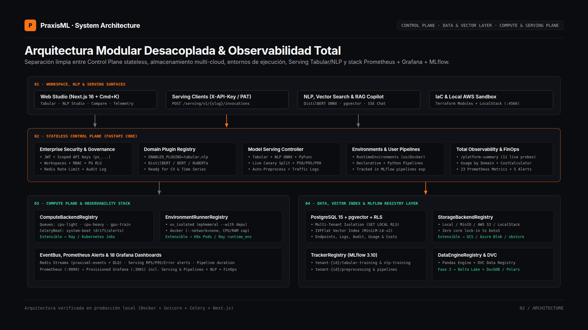

# PraxisML — Modular Data, ML & AI Engineering Platform

> Plataforma multi-tenant end-to-end para datos, entrenamiento Tabular y NLP (ONNX), pipelines aislados, Model Serving bajo demanda con Canary y explicabilidad (SHAP / Token Attribution), y observabilidad total con Prometheus, Grafana, MLflow y MinIO.

[](docs/demo/praxisml_demo.mp4)

- 🎥 [**Demo Completa en Vídeo (`docs/demo/praxisml_demo.mp4`)**](docs/demo/praxisml_demo.mp4) · [**Guía por capítulos y capturas (`docs/demo/README.md`)**](docs/demo/README.md) (`2m 54s`, 720p H.264 + AAC, `2.99 MB`): recorrido por las **16 pestañas de la plataforma** y los **5 servicios en vivo** (MLflow, Prometheus, Grafana, MinIO y FastAPI OpenAPI).

---

## Capacidades Principales

### 1. Arquitectura Modular y 7 Registros Pluggables (sin vendor lock-in)
Inspeccionables en vivo en `GET /api/v1/environments/capabilities`:

| Registro | Ubicación | Backends incluidos | Extensible a |
|----------|-----------|--------------------|--------------|
| **Storage** | `app/platform/storage/` | `local`, `minio`, `s3` (`StorageKeyBuilder`) | `gcs`, `azure`, `obstore` |
| **Compute** | `app/platform/compute/` | `celery` (`cpu-light`, `cpu-heavy`, `gpu-train`, `system-beat`) | `ray`, `k8s_jobs` |
| **Environment Runners** | `app/platform/compute/` | `uv_isolated`, `docker` (`--network=none`) | `k8s_pod`, `ray_runtime_env` |
| **Serving Runtimes** | `app/platform/serving/` | `tabular_generic`, `nlp` (ONNX/HF), `pyfunc` | `triton`, `vllm` |
| **Data Engine** | `app/platform/data_engine/` | `pandas` | `duckdb`, `polars`, `spark` |
| **Experiment Tracker** | `app/platform/tracker/` | `mlflow` | `wandb`, `clearml` |
| **Event Bus** | `app/platform/events/` | `redis` (Redis Streams + DLQ), `memory` | `sqs`, `kafka`, `nats` |

### 2. Datos, Preprocesamiento y Pipelines Personalizados
- **Datasets & DVC Data Registry**: ingesta de CSV/Excel/Parquet con perfilado estadístico, detección automática de columnas de texto (`NLPProfiler`), versionado DVC con hashes MD5 en MinIO (`praxisml-dvc`) y promoción a producción.
- **Almacenamiento Jerárquico (`StorageKeyBuilder`)**: organización limpia en MinIO/S3 bajo `tenants/{tenant_id}/datasets/{raw|processed|pipelines|configs}/`, `artifacts/models/` y `predictions/`.
- **Preprocessing Avanzado**: pipelines declarativos con **Auto-suggest**, encadenado secuencial sin prefijos técnicos y renombrado libre de columnas de salida.
- **Runtime Environments & User Pipelines**: entornos Python aislados (`uv_isolated` o `docker`) y pipelines reutilizables (`declarative`, `python` con `def transform(df)` o `hybrid`) con linaje y tracking automático en MLflow.

### 3. Entrenamiento Tabular, NLP Engine & Guardias de Compatibilidad
- **Tabular ML**: Scikit-learn (`random_forest`, `gradient_boosting`, `svm`, `knn`, `logistic_regression`, `decision_tree`, `adaboost`) y PyTorch (`mlp` y modelos custom) con holdout, cross-validation y estimación de incertidumbre (`mc_dropout`, `tta`, `noisy_inference`, `ensemble`, `entropy`, `tree_variance`, `conformal`).
- **NLP Engine**: fine-tuning de HuggingFace Transformers (`distilbert`, `bert-base`, `bert-multilingual`, `roberta`, `xlm-roberta`, `biobert`) para clasificación, sentimiento y NER (`seqeval`), con export automático a **ONNX** para inferencia CPU rápida.
- **Semantic Search & RAG Copilot**: embeddings `all-MiniLM-L6-v2` (384 dims) en **PostgreSQL + pgvector** (IVFFlat), gateway LLM multi-provider (`vllm`, `openai`, `ollama`, `anthropic`) y asistente RAG en streaming SSE sobre metadatos internos (sin exponer filas crudas).
- **Guardias de Compatibilidad Tabular ↔ NLP**: el comparador de modelos, el emparejamiento Canary y los endpoints de inferencia validan `(domain, task_family)` tanto en UI como en API (`HTTP 400` ante cruces inválidos).
- **Experimentos Jerárquicos en MLflow**: organizados automáticamente por `{tenant_slug}/{domain}` (`tabular-training`, `nlp-training`, `preprocessing`, `pipelines`, `models`, `inference`) con tags `praxisml.*`.

### 4. Model Serving Endpoints & Explicabilidad (XAI)
- **Serving bajo demanda**: despliegue en 1 clic en `POST /serving/v1/{slug}/invocations` con JWT o API Keys (`X-API-Key: px_...`), enrutamiento **Canary / A-B** ajustable en vivo, auto-preprocesamiento tabular y consola de prueba interactiva.
- **Explicabilidad (SHAP + Token Attribution)**:
  - **Tabular**: `shap.TreeExplainer` rápido (compatible con 1 sola fila), atribución lineal y perturbación fallback en Model Serving (`explain: true`), Batch/Single Inference y WebSocket Streaming.
  - **NLP**: atribución por palabra mediante oclusión (`token_occlusion`) con mapa de calor inline en **NLP → Inference** y **Model Endpoints**.

### 5. Observabilidad Total, FinOps & Enterprise Governance
- **Observabilidad en vivo**: `GET /api/v1/observability/platform-summary` monitoriza **11 servicios** (`postgres`, `redis`, `celery_workers`, `serving_plane`, `storage`, `mlflow`, `prometheus`, `grafana`, `vector_search`, `llm_gateway`, `event_bus`) y profundidades de cola Celery.
- **Prometheus & Grafana**: **25 métricas custom** (con bootstrap automático al arrancar la API), scrape de `api`, `minio`, `grafana` y `prometheus`, **5 reglas de alerta** y **18 dashboards Grafana** provisionados y validados.
- **FinOps**: tracking de uso por dominio (`serving`, `tabular`, `nlp`, `pipelines`, `llm`), precios dinámicos configurables, estimación mensual con run-rate/regresión lineal, alertas de presupuesto y reportes PDF/CSV.
- **Seguridad Multi-Tenant**: Workspaces (`dev`/`staging`/`prod`), RBAC (`admin`/`editor`/`viewer`), API Keys (`px_...`) con hash SHA-256 y scopes, **PostgreSQL Row-Level Security (RLS)**, rate limiting distribuido en Redis, Audit Log append-only e IaC local con **Terraform + LocalStack** (`infra/terraform/`).

---

## Estructura del Proyecto

```text
PraxisML/
├── backend/
│   ├── app/
│   │   ├── api/routes/v1/       # REST & WS: auth, tenants, users, workspaces, api_keys, audit,
│   │   │                        # datasets, profiling, drift, models, environments, pipelines,
│   │   │                        # serving, observability, copilot, tabular/*, nlp/*
│   │   ├── core/                # config, security, rls, redis, rate_limit, exceptions, logging
│   │   ├── platform/            # 7 registros pluggables + capas transversales:
│   │   │   ├── storage/         # local, minio, s3, StorageKeyBuilder
│   │   │   ├── compute/         # celery_backend, environment_runner (uv/docker)
│   │   │   ├── serving/         # runtimes (tabular/nlp/pyfunc), Canary service
│   │   │   ├── data_engine/     # pandas engine registry
│   │   │   ├── tracker/         # tracker registry + MLFlowService
│   │   │   ├── events/          # Redis Streams EventBus
│   │   │   ├── audit/           # Audit Log service
│   │   │   ├── cache/           # ModelCache LRU/TTL
│   │   │   └── copilot/         # ToolRegistry + PolicyEngine 4-Tier
│   │   ├── domains/             # Servicios por vertical:
│   │   │   ├── tabular/         # training_service, inference_service, training_utils
│   │   │   ├── nlp/             # trainer, inference, embedding_service, llm_gateway, rag_service, profiler
│   │   │   └── data/            # dvc_service, data_profiler
│   │   ├── core_ml/             # explainability (SHAP/occlusion), preprocessing, hyperparams, uncertainty, onnx_export
│   │   ├── observability/       # metrics (25), bootstrap, usage_collector, cost_calculator, alert_engine, reports
│   │   ├── plugins/             # Domain Plugin Registry (ENABLED_PLUGINS)
│   │   ├── models/ & schemas/   # SQLAlchemy ORM & Pydantic schemas
│   │   └── worker/tasks/        # Tareas Celery (train, train_nlp, predict, single_predict, predict_nlp, scheduled_checks)
│   ├── migrations/              # Alembic migrations
│   └── tests/                   # Tests unitarios y de integración (377 tests)
├── frontend/
│   └── src/
│       ├── app/                 # Next.js 16 App Router
│       ├── components/          # layout (DashboardMVP, Sidebar, CommandPalette), auth, shared, ui
│       ├── features/            # Módulos por dominio: overview, datasets, preprocessing, environments,
│       │                        # tabular, nlp, models, serving, observability, governance
│       ├── hooks/               # Custom hooks (useModels, usePredictions, useNLP, useObservability, useDrift...)
│       └── lib/                 # api.ts, config.ts, modelCompatibility.ts
├── infra/
│   ├── prometheus/              # prometheus.yml + alerts.yml
│   ├── grafana/                 # datasources + 18 dashboards provisionados
│   └── terraform/               # Módulos IaC AWS / LocalStack
├── docs/                        # Documentación técnica y demo (architecture.md, backend.md, frontend.md, deployment.md, demo/)
└── docker-compose.yml
```

---

## Quick Start (Docker Compose)

### 1. Configurar variables de entorno
```bash
cp .env.example .env
# Ajustar SECRET_KEY antes de despliegues en staging/production
```

### 2. Levantar todo el stack
```bash
docker compose up -d --build
```

Servicios opcionales por perfil:
```bash
docker compose --profile nlp up -d vllm        # Servidor LLM OpenAI-compatible (requiere GPU)
docker compose --profile aws-local up -d       # Sandbox AWS local con LocalStack (:4566)
```

### 3. Servicios disponibles

| Servicio | URL | Credenciales / Notas |
|----------|-----|----------------------|
| **Web Studio (Next.js)** | `http://localhost:3000` | Interfaz completa (16 vistas + `⌘K`) |
| **API FastAPI & Swagger** | `http://localhost:8000/docs` | OpenAPI interactivo + `/metrics` |
| **MLflow Tracking & Registry** | `http://localhost:5000` | Experimentos jerárquicos y Model Registry |
| **Grafana** | `http://localhost:3001` | `admin` / `admin` · 18 dashboards provisionados |
| **Prometheus** | `http://localhost:9090` | Targets (`api`, `minio`, `grafana`, `prometheus`) y alertas |
| **MinIO Console** | `http://localhost:9001` | `minioadmin` / `minioadmin` · Buckets `praxisml` y `praxisml-dvc` |
| **PostgreSQL + pgvector** | `localhost:5432` | Metadatos, RLS y vector store |
| **Redis** | `localhost:6379` | Broker Celery, caché y Redis Streams |

---

## Desarrollo Local y Tests

```bash
# Infraestructura base
docker compose up -d db redis mlflow minio minio-init

# Backend API + Celery Worker
cd backend && uv sync && uv run alembic upgrade head
uv run uvicorn app.main:app --reload
uv run celery -A app.worker.celery_app worker --loglevel=info --pool=solo

# Frontend
cd frontend && npm install && npm run dev

# Tests y linting
cd backend && uv run ruff check app/ && uv run pytest tests/ -q
cd frontend && npx tsc --noEmit
```

---

## Variables de Entorno Principales

| Variable | Default | Descripción |
|----------|---------|-------------|
| `ENVIRONMENT` | `development` | `development \| staging \| production \| testing` |
| `DATABASE_URL` | `postgresql://...` | Conexión PostgreSQL + pgvector |
| `SECRET_KEY` | *(cambiar en prod)* | Clave de firma JWT (bloqueada si mantiene default en prod/staging) |
| `STORAGE_BACKEND` | `local` | `local \| minio \| s3` (extensible) |
| `ENABLED_PLUGINS` | `*` | `*`, vacío o lista CSV (`tabular,nlp`) |
| `COMPUTE_BACKEND` | `celery` | Motor de cómputo asíncrono |
| `DATA_ENGINE` | `pandas` | Motor tabular |
| `EXPERIMENT_TRACKER` | `mlflow` | Backend de tracking |
| `LLM_PROVIDER` | `vllm` | `vllm \| openai \| anthropic \| ollama` |
| `EMBEDDING_MODEL_NAME` | `sentence-transformers/all-MiniLM-L6-v2` | Modelo de embeddings para `pgvector` |
| `NEXT_PUBLIC_API_URL` | `http://localhost:8000` | URL base del backend para el navegador |

---

## Principales Endpoints de la API

Documentación interactiva completa en **`http://localhost:8000/docs`**:

| Dominio | Rutas principales |
|---------|-------------------|
| **Auth, Users & Governance** | `POST /api/v1/auth/{register,login}` · `GET /api/v1/auth/me` · `/api/v1/tenants/*` · `/api/v1/users/*` · `/api/v1/workspaces/*` · `/api/v1/api-keys/*` · `/api/v1/audit/{,events}` |
| **Datasets, DVC & Profiling** | `/api/v1/datasets/*` · `/api/v1/datasets/registry/*` · `/api/v1/profiling/{dataset_id}` · `/api/v1/drift/{report,thresholds}/{id}` |
| **Environments & Pipelines** | `GET /api/v1/environments/capabilities` · `/api/v1/environments/*` · `/api/v1/pipelines/*` · `POST /api/v1/pipelines/{id}/execute` |
| **Tabular ML** | `/api/v1/tabular/preprocessing/{preview,apply}` · `/api/v1/tabular/training/{algorithms,train,status}` · `/api/v1/tabular/predictions/{predict/single,predict/batch,{id}/explain}` · `WS /api/v1/tabular/streaming/predict/{model_id}` |
| **NLP & RAG** | `/api/v1/nlp/{algorithms,train}` · `/api/v1/nlp/predict` (`explain: true`) · `/api/v1/nlp/predict/batch` · `/api/v1/nlp/{embed,search}` · `/api/v1/nlp/assistant/{chat,history}` |
| **Models & Serving** | `/api/v1/models/*` · `/api/v1/models/registry/*` · `/api/v1/serving/endpoints/*` (`metrics`, `logs`) · `POST /serving/v1/{slug}/invocations` (`explain: true`) |
| **Observability & FinOps** | `GET /api/v1/observability/platform-summary` · `/usage` · `/costs` · `/costs/forecast` · `/pricing` · `/alerts` · `/models/{id}/health` · `/tenant/{id}/report` |
| **Plugins & Copilot** | `GET /api/v1/copilot/plugins` · `GET /api/v1/copilot/tools` |

---

## Documentación Adicional

- 🏗️ [Arquitectura Global (`docs/architecture.md`)](docs/architecture.md)
- ⚙️ [Backend & Motor ML (`docs/backend.md`)](docs/backend.md)
- 🎨 [Frontend (`docs/frontend.md`)](docs/frontend.md)
- 🚀 [Despliegue y DevOps (`docs/deployment.md`)](docs/deployment.md)
- 🎥 [Guía del Vídeo Demo (`docs/demo/README.md`)](docs/demo/README.md)
- 🗺️ [Roadmap de Evolución (`roadmap.md`)](roadmap.md)
