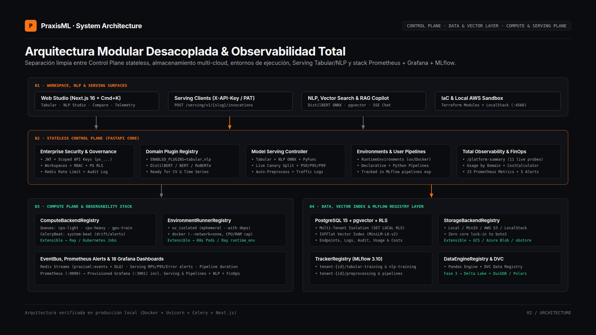

# Architecture Overview

## System Components

```
┌─────────────┐     ┌─────────────────────────────────────────────────────┐
│   Frontend  │     │                   Backend API                       │
│  (Next.js)  │◄───►│              FastAPI + Celery                       │
│             │     │                                                     │
│  Port 3000  │     │  ┌────────────┐  ┌────────────┐  ┌──────────────┐  │
└─────────────┘     │  │ REST API   │  │ WebSocket  │  │ Celery       │  │
                    │  │ Port 8000  │  │ Port 8000  │  │ Workers      │  │
                    │  └─────┬──────┘  └──────┬─────┘  └──────┬───────┘  │
                    │        │                 │               │          │
                    └────────┼─────────────────┼───────────────┼──────────┘
                             │                 │               │
                    ┌────────▼─────┐   ┌───────▼───────┐  ┌────▼──────┐
                    │  PostgreSQL  │   │     Redis     │  │  MLflow   │
                    │  + pgvector  │   │  (Celery +    │  │ (Tracking │
                    │ (metadata +  │   │   Cache)      │  │+ Registry)│
                    │  embeddings) │   └───────────────┘  └────┬──────┘
                    └──────────────┘                           │
                    ┌───────────────────────────────────────────┼──────────┐
                    │           Storage Layer                   │          │
                    │  ┌─────────┐  ┌─────────┐  ┌─────────┐   │          │
                    │  │  Local  │  │  MinIO  │  │   S3    │   │          │
                    │  │ (dev)   │  │(self-   │  │ (AWS)   │   │          │
                    │  │         │  │ hosted) │  │         │   │          │
                    │  └─────────┘  └─────────┘  └─────────┘   │          │
                    └───────────────────────────────────────────┼──────────┘
                                                               │
                                                  ┌────────────▼───────┐
                                                  │   DVC (Data       │
                                                  │   Versioning)     │
                                                  │   MinIO/S3 remote │
                                                  └───────────────────┘

  ┌───────────────┐  (Opcional, profile "nlp", requiere GPU)
  │ vLLM Server   │──► API OpenAI-compatible (/v1) → LLM Gateway (asistente RAG)
  │  Port 8001    │
  └───────────────┘
```

## NLP Vertical (Fase 1)

Router único `/api/v1/nlp/*` con cuatro submódulos:

```
/api/v1/nlp
├── training.py     → GET /algorithms · POST /train · GET /training/status/{task_id}
├── inference.py    → POST /predict · POST /predict/batch · WS /streaming/{model_id}
├── embeddings.py   → POST /embed · GET /search
└── assistant.py    → POST /assistant/chat (JSON/SSE) · GET/DELETE /assistant/history
```

- **NLP Clásico**: `NLPTrainer` (HF Transformers) → export ONNX (`torch.onnx.export`) → `NLPInferenceService` (ONNX Runtime en CPU).
- **Semantic Search**: `EmbeddingService` (sentence-transformers, 384d) → tabla `model_embeddings` (pgvector, índice IVFFlat) → búsqueda `<=>` coseno.
- **Generativo**: `LLMGateway` (vLLM default, OpenAI-compatible) + `RAGService` (contexto solo-metadatos) → asistente con SSE.
- **Observabilidad**: métricas `praxisml_nlp_*` y `praxisml_llm_*`, dashboard Grafana `praxisml-nlp`.

## Data Flow

### Training Pipeline

```
1. Dataset Upload ──► StorageService ──► DVC (versioned)
       │
2. Preprocessing ──► build_pipeline() ──► MLflow (saved as artifact)
       │
3. Training ──► SklearnTrainer / PyTorchTrainer / NLPTrainer ──► MLflow (autolog)
       │
4. Model Registration ──► MLflow Registry + DB (MLModel table)
       │
5. Inference ──► InferenceService / NLPInferenceService ──► Uncertainty estimation ──► Result
```

### NLP Pipeline (Fase 1)

```
1. Upload CSV ──► NLP Profiler hook ──► column_types_analysis + index_dataset (embedding)
       │
2. Train ──► NLPTrainer (HF Trainer) ──► MLflow (tenant_{id}_nlp_training) + export ONNX
       │
3. Index ──► EmbeddingService.index_model ──► model_embeddings (pgvector)
       │
4. Inference ──► ONNX Runtime / transformers ──► {label, confidence, entities[], tokens[], latency_ms}
       │
5. Chat ──► RAGService (metadatos) ──► LLMGateway (vLLM) ──► SSE al frontend
```

### Inference Flow

```
Sync:  Client ──► API ──► InferenceService ──► Model (TorchScript/MLflow) ──► Response
Async: Client ──► API ──► Celery Task ──► InferenceService ──► Poll for result
Stream: WebSocket ──► API ──► InferenceService ──► Stream results
LLM:    Client ──► API ──► RAGService + LLMGateway ──► SSE stream
```

## Multi-Tenant Isolation & Resource Organization

- **Database**: All tables have `tenant_id` foreign key + PostgreSQL RLS (`SET LOCAL app.current_tenant_id`)
- **Storage (MinIO / S3 / Local)** via `StorageKeyBuilder`:
  ```text
  praxisml/
  ├── tenants/{tenant_id}/
  │   ├── datasets/
  │   │   ├── raw/{filename}          # Original uploaded datasets
  │   │   ├── processed/{filename}    # Preprocessing pipeline outputs
  │   │   ├── pipelines/{filename}    # UserPipeline outputs
  │   │   └── configs/{filename}      # Optional dataset JSON configs
  │   ├── artifacts/models/{model_id}/{filename}
  │   └── predictions/{prediction_id}/{filename}
  └── mlruns/{experiment_id}/{run_id}/artifacts/...
  ```
- **MLflow Experiments** via `MLFlowService.ensure_tenant_experiment()`: hierarchical naming `{tenant_slug}/{domain}` (or `tenant-{short_id}/{domain}`) with domains `tabular-training`, `nlp-training`, `preprocessing`, `pipelines`, `models`, `inference`, tagged with `praxisml.tenant_id`, `praxisml.domain`, and `praxisml.managed_by=praxisml`.
- **Domain Compatibility Guards**: Model comparison, Canary endpoint pairing, and Tabular/NLP inference enforce `(domain, task_family)` compatibility across UI and API.
- **DVC**: Separate repository per tenant (`praxisml-dvc/{tenant_id}/files/md5/...`)
- **Embeddings**: `model_embeddings` filtered by `tenant_id` + semantic search returns only tenant rows
- **Auth & RBAC**: JWT tokens + Scoped API Keys (`px_...`), 3 roles per tenant (`admin`, `editor`, `viewer`)

## Key Design Decisions

1. **StorageService abstraction** — Pluggable backends (Local/MinIO/S3) via `STORAGE_BACKEND` env var
2. **Declarative preprocessing** — JSON config → sklearn `ColumnTransformer` pipeline
3. **PyTorch uncertainty** — Extensible via `IUncertaintyAlgorithm` interface
4. **Async training** — Celery workers prevent API blocking
5. **Model cache** — LRU + TTL for inference performance
6. **ONNX export nativo** — `torch.onnx.export` (sin `optimum`, incompatible con torch ≥2.9) → inferencia CPU con `onnxruntime`
7. **VectorType dual** — `vector(384)` en PostgreSQL (pgvector) / `JSON` en SQLite para poder testear sin servidor pgvector
8. **LLM via OpenAI-compatible** — vLLM/OpenAI/Ollama comparten el SDK `openai` con distinta `base_url`; Anthropic usa SDK nativo
9. **RAG solo-metadatos** — el LLM nunca recibe datos crudos de los datasets (privacidad multi-tenant)

---

## Modular Core, Pluggable Registries & Model Serving (Fase 2)



> 🎥 **Walkthrough en vídeo:** [praxisml_demo.mp4](./demo/praxisml_demo.mp4) · [Guía por capítulos](./demo/README.md)

A partir de Fase 2, el Control Plane en FastAPI queda completamente desacoplado de librerías y proveedores concretos mediante **7 registros pluggables** inspeccionables en vivo en `GET /api/v1/environments/capabilities`:

| Registro | Contrato ABC | Backends incluidos | Extensible a |
|---|---|---|---|
| **Storage** | `StorageService` | `local`, `minio`, `s3` | `gcs`, `azure`, `obstore` |
| **Compute** | `ComputeBackend` | `celery` (colas `cpu-light`, `cpu-heavy`, `gpu-train`, `system-beat`) | `ray`, `k8s_jobs` |
| **Environment Runners** | `EnvironmentRunner` | `uv_isolated`, `docker` (`--network=none`) | `k8s_pod`, `ray_runtime_env` |
| **Serving Runtimes** | `ModelRuntime` | `tabular_generic`, `nlp`, `pyfunc` (universal MLflow) | `onnxruntime`, `triton`, `vllm` |
| **Event Bus** | `EventBusBackend` | `redis` (Redis Streams + DLQ), `memory` | `sqs`, `kafka`, `nats` |
| **Data Engine** | `DataEngine` | `pandas` | `duckdb`, `polars`, `spark` |
| **Experiment Tracker** | `ExperimentTracker` | `mlflow` | `wandb`, `clearml` |

### Runtime Environments & User-Defined Pipelines
- **`RuntimeEnvironment`** (`/api/v1/environments/*`): define versión de Python, imagen base, paquetes PyPI/uv, variables de entorno y runner (`uv_isolated` o `docker`).
- **`UserPipeline`** (`/api/v1/pipelines/*`): pipelines reutilizables en modo `declarative`, `python` (`def transform(df)`) o `hybrid`, ejecutables sobre cualquier dataset del tenant con linaje (`parent_dataset_id`).

### Dedicated Model Serving Endpoints (Lite Serving v1)
```text
Client (X-API-Key: px_... o JWT)
   └─► POST /serving/v1/{slug}/invocations
         ├─► Canary / A-B Router (model_id vs secondary_model_id según traffic_split_pct)
         ├─► Auto-Preprocess (aplica preprocessing_pipeline_path si el payload llega crudo)
         ├─► ModelRuntimeRegistry (tabular_generic | nlp | pyfunc)
         └─► EndpointInvocationLog + EventBus (endpoint.invoked) + Métricas de latencia
```

### Enterprise Security & IaC Local
- **Aislamiento reforzado**: `Workspaces` (`dev`/`staging`/`prod`), **API Keys (`px_...`)** con hash SHA-256 y scopes, **PostgreSQL Row-Level Security (RLS)** (`SET LOCAL app.current_tenant_id`), Rate Limiting distribuido en Redis por tenant/API key y tabla append-only `audit_log`.
- **IaC Local ($0)**: Módulos Terraform reutilizables en `infra/terraform/` + perfil Docker `aws-local` (LocalStack Community `:4566`).
