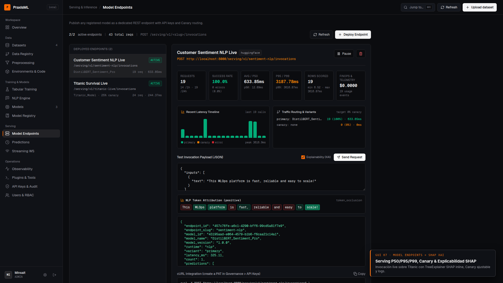
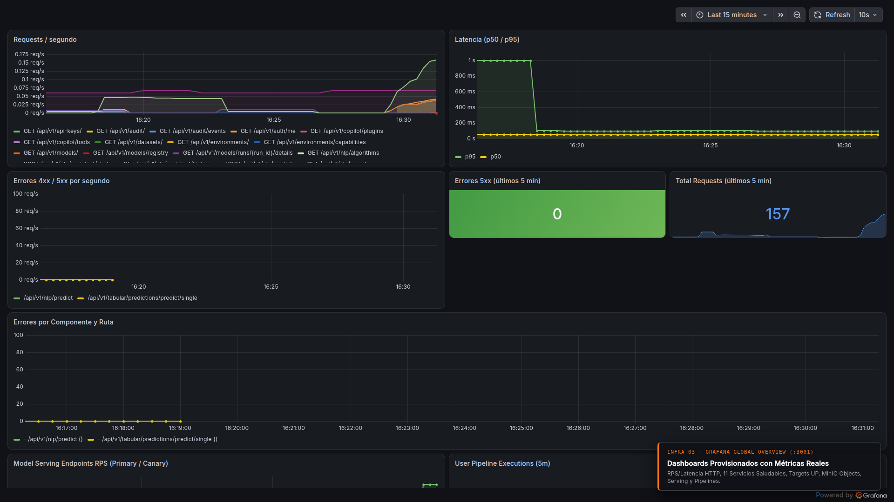

# PraxisML — Demo & Walkthrough Completo (Tabular + NLP + Serving + Grafana + Observabilidad Total)

> **Vídeo completo (`2m 38s`, 720p H.264 Main@3.1 + AAC, ~2.75 MB):**  
> ▶️ [**Ver / Descargar `praxisml_demo.mp4`**](./praxisml_demo.mp4) *(compatible con GitHub, navegadores, VLC y WhatsApp)*

---

## Capítulos del Vídeo

| Tiempo | Sección | Qué muestra |
|---|---|---|
| `0:00 – 0:05` | **Intro & Métricas** | Resumen ejecutivo (`98+` rutas API, `11` servicios monitorizados en vivo, `18` dashboards Grafana + `5` alertas Prometheus, `7` registros pluggables). |
| `0:05 – 0:12` | **Arquitectura Modular** | Separación de *Workspace/NLP*, *Control Plane*, *Compute & Observability Stack* y *Data/Vector/MLflow Layer*. |
| `0:12 – 0:18` | **Ciclo de Vida & 7 Registros** | Flujo end-to-end Tabular + NLP ONNX y mapa de extensibilidad sin lock-in a librerías ni clouds. |
| `0:18 – 0:46` | **Overview, Datasets, Preprocessing & Environments** | 6 KPIs + barra de servicios en vivo, datasets tabulares y texto (`customer_reviews_nlp`), Auto-suggest + renombrado libre de variables, `RuntimeEnvironments` (`uv`/`docker`), `def transform(df)` y **Pluggable Backends**. |
| `0:46 – 1:15` | **Models Compatibility Guard & NLP Studio + XAI** | Guardia de compatibilidad Tabular vs NLP (`Titanic_Model` bloquea `DistilBERT_Sentiment_Pro`), comparador lado a lado, Fine-tuning HuggingFace DistilBERT + ONNX, **Inferencia NLP con mapa de calor de atribución por palabra (`token_occlusion`)**, **Búsqueda Semántica (`pgvector`)** y **RAG Copilot**. |
| `1:15 – 1:40` | **Model Endpoints + Explicabilidad SHAP & Token XAI** | Métricas por endpoint (**P50/P95/P99**, success/error rate, latency timeline, tráfico Primary vs Canary ajustable en vivo, logs filtrables) e invocación real con **`explain: true`** mostrando **SHAP `TreeExplainer`** en `/serving/v1/titanic-live` y **atribución por palabra** en `/serving/v1/sentiment-nlp`. |
| `1:34 – 1:58` | **Observability Total, Governance, Plugins & `Cmd+K`** | Panel de **11 servicios y colas**, uso filtrado por dominio (`serving`, `tabular`, `nlp`, `pipelines`, `llm`), API Keys (`px_...`), Audit Log, Plugins y **Command Palette (`⌘K`)**. |
| `1:58 – 2:21` | **Infraestructura en Vivo (MLflow, Prometheus, Grafana & MinIO)** | Experimentos jerárquicos en **MLflow (`:5000`)**, **Prometheus Targets (`:9090`)** 100% UP (`api`, `minio`, `grafana`, `prometheus`), dashboards provisionados en **Grafana (`:3001`)** (*Global Overview* + *Model Serving & Pipelines* con métricas reales) y estructura jerárquica en **MinIO (`:9001`)** (`datasets/raw`, `processed`, `pipelines`). |
| `2:21 – 2:27` | **Roadmap v2.0** | Fases 0–2 completadas y próximos hitos (Fase 3 Lakehouse Delta/DuckDB/Monitoring, Fases 4–5). |

---

## Capturas Clave

### Flujo End-to-End & 7 Registros Pluggables

### Model Serving Endpoints — Observabilidad P50/P95/P99, Canary & Live Console

### Grafana Global Overview — Métricas en Vivo (HTTP, 11 Servicios, Targets & Serving)

