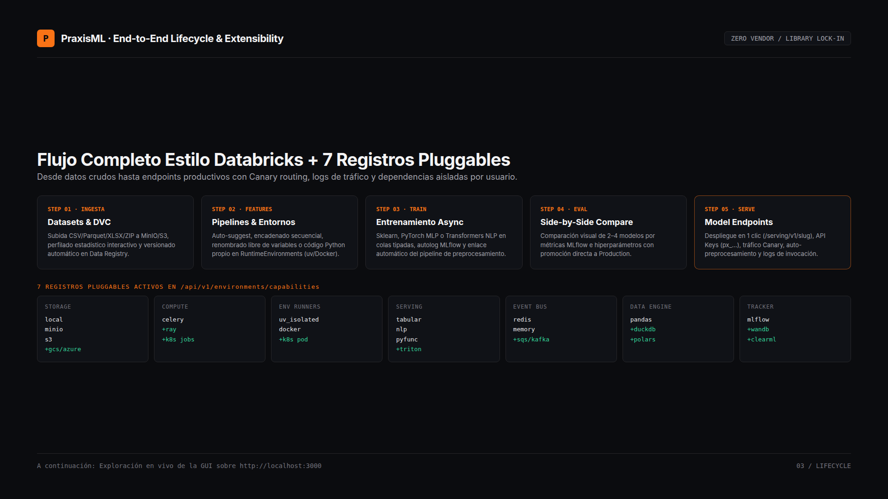

# PraxisML — Demo & Walkthrough (Fases 0–2)

> **Vídeo completo (`1m 44s`, 720p H.264 Main@3.1 + AAC, 3.0 MB):**  
> ▶️ [**Ver / Descargar `praxisml_demo.mp4`**](./praxisml_demo.mp4) *(compatible con GitHub, navegadores, VLC y WhatsApp)*

---

## Capítulos del Vídeo

| Tiempo | Sección | Qué muestra |
|---|---|---|
| `0:00 – 0:06` | **Intro & Métricas** | Resumen ejecutivo (`96` rutas API, `7` registros pluggables, `362` tests pasando, stack completo). |
| `0:06 – 0:13` | **Arquitectura Modular** | Separación de *Workspace*, *Control Plane*, *Compute & Runtime Environments* y *Multi-Cloud Storage & Registry Layer*. |
| `0:13 – 0:21` | **Ciclo de Vida & 7 Registros** | Flujo estilo Databricks y mapa de extensibilidad sin lock-in a librerías ni clouds. |
| `0:21 – 0:46` | **Workspace, Datasets, DVC & Preprocessing** | Vista general, Titanic v1/v2, Data Registry DVC, DataProfiler, **Auto-suggest**, chips clicables y renombrado libre de variables. |
| `0:46 – 1:02` | **Environments & Custom Code** | `RuntimeEnvironments` aislados (`uv`/`docker`), pipelines Python `def transform(df)` y panel en vivo de **Pluggable Backends**. |
| `1:02 – 1:18` | **Training, Models & Side-by-Side Compare** | Entrenamiento tabular MLflow y comparador visual lado a lado de `Titanic_Model` vs `Titanic_GBM_Canary`. |
| `1:18 – 1:30` | **Model Endpoints, Canary & Invocation Logs** | Invocación en vivo en `/serving/v1/titanic-live/invocations` (`25%` Canary, auto-preprocesamiento) + cURL + logs recientes. |
| `1:30 – 1:38` | **Governance, Observability, Copilot & `Cmd+K`** | API Keys (`px_...`), Workspaces, Audit Log / Redis Streams, FinOps, Plugins y **Command Palette (`⌘K`)**. |
| `1:38 – 1:44` | **Roadmap v2.0** | Fases 0–2 completadas y próximos hitos (Fase 3 Lakehouse Delta/DuckDB/Monitoring, Fases 4–5). |

---

## Capturas Clave

### Flujo End-to-End & 7 Registros Pluggables

### Model Serving Endpoints & Live Console

