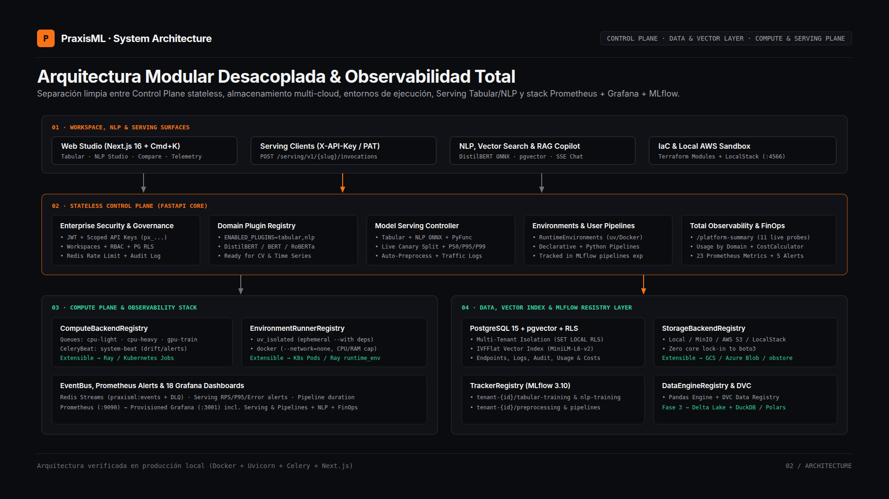

# PraxisML — Demo & Walkthrough Completo (Tabular + NLP + Serving + Grafana + Observabilidad Total)

> **Vídeo completo (`2m 54s`, 720p H.264 Main@3.1 + AAC, ~2.99 MB):**  
> ▶️ [**Ver / Descargar `praxisml_demo.mp4`**](./praxisml_demo.mp4) *(compatible con GitHub, navegadores, VLC y WhatsApp)*

---

## Capítulos del Vídeo

| Tiempo | Sección | Qué muestra |
|---|---|---|
| `0:00 – 0:05` | **Intro & Métricas** | Resumen ejecutivo (`98+` rutas API, `11` servicios monitorizados en vivo, `18` dashboards Grafana + `5` alertas Prometheus, `7` registros pluggables). |
| `0:05 – 0:12` | **Arquitectura Modular** | Separación de *Workspace/NLP*, *Control Plane*, *Compute & Observability Stack* y *Data/Vector/MLflow Layer*. |
| `0:12 – 0:18` | **Ciclo de Vida & 7 Registros** | Flujo end-to-end Tabular + NLP ONNX y mapa de extensibilidad sin lock-in a librerías ni clouds. |
| `0:18 – 0:55` | **Workspace, Datasets, Data Registry (DVC), Preprocessing, Environments & Tabular Training** | 6 KPIs + 11 servicios en vivo, Preview de datasets, versionado DVC en MinIO, Auto-suggest + renombrado libre, `RuntimeEnvironments` (`uv`/`docker`), `def transform(df)`, 7 registros pluggables y formulario de **Tabular Training**. |
| `0:55 – 1:25` | **NLP Engine Completo + Asistente RAG + Guardia de Compatibilidad** | Fine-tuning HuggingFace DistilBERT + ONNX, **Inferencia NLP con mapa de calor de atribución por palabra**, **Búsqueda Semántica (`pgvector`)**, **Asistente RAG con respuesta completa en vivo** (metadatos sin filas crudas), **Guardia de Compatibilidad Tabular vs NLP** + comparador lado a lado y **MLflow Model Registry**. |
| `1:25 – 1:55` | **Model Endpoints (SHAP + Token XAI), Predictions & Streaming WS** | Invocación live en **`Titanic Survival Live`** (Canary 25%, P50/P95/P99 y barras **SHAP `TreeExplainer`**) y **`Customer Sentiment NLP Live`** (**atribución por palabra `token_occlusion`**), tab **Predictions** (Batch/Single con SHAP y NLP filtrado) y **Streaming WebSocket**. |
| `1:55 – 2:22` | **Observability Total, Plugins, Governance, Users RBAC & `Cmd+K`** | Panel de **11 servicios y colas**, **Usage** por dominio, **Costs**, **Alerts**, **Plugins & PolicyEngine**, **API Keys (`px_...`) + Audit Log**, **Users & RBAC** y **Command Palette (`⌘K`)**. |
| `2:22 – 2:48` | **5 Servicios de Infraestructura en Vivo** | **MLflow (`:5000`)** con experimentos jerárquicos, **Prometheus (`:9090/targets`)** 100% UP, **Grafana (`:3001`)** (*Global Overview* arriba + paneles de 11 servicios/Targets/MinIO + *Model Serving & Pipelines*), **MinIO (`:9001`)** (`datasets/raw`, `processed`, `pipelines`) y **FastAPI Swagger OpenAPI (`:8000/docs`)**. |
| `2:48 – 2:54` | **Roadmap v2.0** | Fases 0–2 completadas y próximos hitos (Fase 3 Lakehouse Delta/DuckDB/Monitoring, Fases 4–5). |

---

## Capturas Clave

### Flujo End-to-End & 7 Registros Pluggables

### Model Serving Endpoints — Observabilidad P50/P95/P99, Canary & Live Console

### Grafana Global Overview — Métricas en Vivo (HTTP, 11 Servicios, Targets & Serving)

