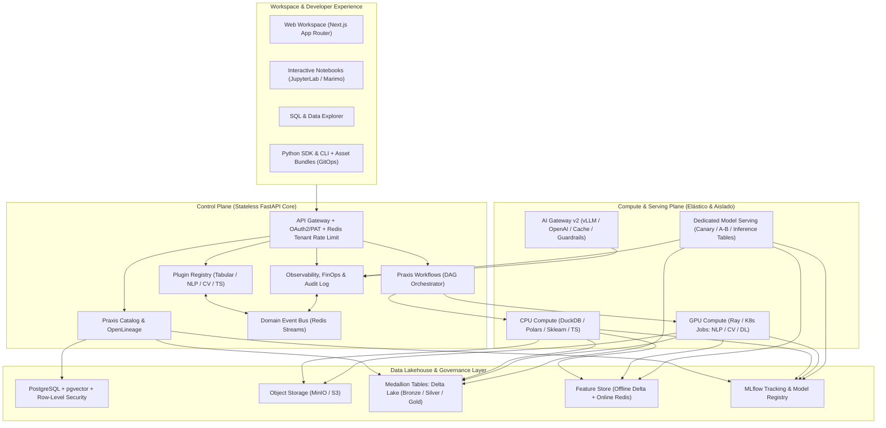

# 🗺️ Roadmap de Evolución Tecnológica — PraxisML
# Plataforma Modular de Datos, ML & IA (Estilo Lakehouse / Databricks)

> **Versión del Roadmap:** 2.0 (Reestructuración Modular & Lakehouse)  
> **Fecha de actualización:** 2026-11-25  
> **Estado actual del repositorio:** **Fase 0 ✅ Completada** (Observabilidad & FinOps) · **Fase 1 ✅ Completada** (NLP Engine + pgvector + vLLM RAG) · **Fase 2 ✅ Completada** (Core Modular, Compute Plane, Enterprise Security, LocalStack IaC & Model Serving Endpoints v1)  
> **Base técnica actual:** FastAPI · Celery + Redis Streams · PostgreSQL (`pgvector` + RLS) · MLflow 3.10 · MinIO/S3 · DVC · Next.js 16 · Prometheus/Grafana · Terraform LocalStack · vLLM opcional  
> 🎥 **Vídeo Demo (Fases 0–2):** [docs/demo/praxisml_demo.mp4](docs/demo/praxisml_demo.mp4) · [Guía y capturas](docs/demo/README.md)  

> 📁 **Especificaciones detalladas por fase:**
> - ✅ [Fase 0 — Observabilidad, Cost Tracking & FinOps](roadmap/phase-0-observability.md) · [Catálogo de métricas](roadmap/metrics-catalog.md) · [Plan de implementación F0](roadmap/phase-0-implementation-plan.md)
> - ✅ [Fase 1 — NLP Engine (Clásico + Embeddings + LLM RAG)](roadmap/phase-1-nlp.md) · [Plan ejecutado F1](docs/plan-fase-1-nlp-engine.md)
> - ✅ [Fase 2 — Modularización del Core, Compute Plane, Runtime Environments & Model Serving v1](roadmap/phase-2-modular-core-compute.md)
> - 🚧 [Fase 3 — Data Lakehouse, Praxis Catalog, Workflows & Feature Store](roadmap/phase-3-lakehouse-catalog-workflows.md)
> - 📐 [Fase 4 — Dedicated Model Serving, Workspace Interactivo & Verticales CV/TS](roadmap/phase-4-serving-workspace-verticals.md) · [Detalle CV & Time Series](roadmap/phase-2-cv-timeseries.md)
> - 📐 [Fase 5 — Smart Platform, Agentic Copilot & Cloud-Native Scale](roadmap/phase-3-smart-platform.md) · [AI DevOps & Copilot](roadmap/phase-4-ai-devops.md)

---

## 1. Diagnóstico Arquitectónico del Estado Actual

Antes de seguir apilando verticales de ML (Computer Vision, Time Series, AutoML, Copilot), un análisis profundo del repositorio revela tanto **fortalezas muy sólidas** como **cuellos de botella estructurales** que conviene resolver primero para escalar como una plataforma modular comparable en pilares a Databricks.

### ✅ Qué está bien hecho (Fortalezas a preservar)

| Pilar | Implementación actual | Valor arquitectónico |
|---|---|---|
| **Multi-tenancy & Seguridad base** | `tenant_id` en tablas ORM, prefijos `tenants/{id}/` en Storage y MLflow, RBAC (`admin > editor > viewer`), cuotas por tenant y validación estricta de `SECRET_KEY` en `config.py`. | Cimiento SaaS claro desde el inicio; fácil de reforzar con RLS y Service Principals. |
| **Abstracciones limpias puntuales** | `StorageService` (Local/MinIO/S3), `IUncertaintyAlgorithm` + `PredictionFactory`, `VectorType` dual (pgvector/JSON) y `LLMGateway` multi-provider sin lock-in a LangChain. | Demuestra buen criterio de desacople cuando se diseña por contrato. |
| **Observabilidad y FinOps (Fase 0)** | `UsageCollector`, `CostCalculator` con `resource_pricing` dinámico + caché Redis, `AlertEngine`, Celery Beat, 19 métricas Prometheus, 7+ dashboards Grafana y UI integrada. | Ventaja diferencial temprana: visibilidad de costes y latencia antes de escalar el cómputo. |
| **Vertical NLP end-to-end (Fase 1)** | Transformers + export ONNX nativo (`torch.onnx.export`), `seqeval` (NER), embeddings `all-MiniLM-L6-v2` + `pgvector`, `vLLM` default + **RAG solo-metadatos** (privacidad multi-tenant). | Valida el ciclo completo multi-modal en backend, worker, migraciones, métricas y UI. |
| **Ciclo MLOps base** | MLflow Tracking & Registry, DVC Data Registry, Evidently Drift (PSI/KS), SHAP XAI, WebSocket Streaming, SSE y `model_ci.yml`. | Cobertura funcional amplia para ML tabular y NLP sobre un stack reproducible con `uv` y Docker Compose. |

### ⚠️ Qué hay que mejorar (Deuda técnica y brechas de escalabilidad)

| Dimensión | Problema detectado en el código actual | Impacto si no se corrige |
|---|---|---|
| **Modularidad y Plugins** | `SklearnTrainer`/`PyTorchTrainer` (`training_service.py`, 1,104 LOC) y `NLPTrainer` (`nlp_trainer.py`, 518 LOC) no comparten contrato (`BaseTrainer` / `DomainPlugin`). `train.py` (262 LOC) y `train_nlp.py` (260 LOC) duplican toda la tubería. `models.py` (838 LOC) y `datasets.py` (640 LOC) son *fat routers* y `services/` está plano. | Añadir CV y Time Series multiplicará la duplicación ×4 y hará el código difícil de mantener y testear. |
| **Dependencias e Imágenes monolíticas** | `backend/pyproject.toml` mete `torch`, `transformers`, `sentence-transformers`, `onnxruntime`, `shap`, `evidently`, `dvc`, `mlflow` en una única imagen compartida por `api`, `worker` y `celery-beat`. | Imágenes >12–15 GB al sumar CV/TS, arranques lentos y conflictos de dependencias (como `optimum` vs `torch 2.10`). |
| **Capa de Datos y Escalado Stateless** | `train.py` / `datasets.py` descargan ficheros enteros a RAM (`BytesIO` + `pandas`). `DVCService` lanza `subprocess.run(["dvc", ...])` sobre disco local (`DATA_DIR/storage`). | Colapsa con datasets >1–2 GB; **rompe el escalado horizontal** en múltiples réplicas/pods y provoca carreras en escrituras concurrentes. |
| **Control Plane acoplado al Compute/Serving** | `celery_app.py` tiene `task_routes = {}` (una sola cola con `--pool=prefork`, incompatible con GPU/CUDA). `InferenceService` carga modelos en la RAM de FastAPI con `ModelCache` local (y `Path(torchscript_path).exists()` falla si solo vive en S3/MinIO). `main.py` lanza `mlflow ui` como subproceso. | Un entrenamiento bloquea inferencias y alertas; imposible escalar API independientemente del Model Serving; sin A/B, Canary ni GPU isolation. |
| **Sin Lakehouse, Catálogo Unificado ni Workflows** | Metadatos fragmentados en 5 sitios (`dataset`, `.dvc`, `ml_model`, `mlflow_db`, `model_embeddings`). Sin linaje, sin Feature Store y sin motor de DAGs/pipelines declarativos. | Uso 100% manual paso a paso; *training-serving skew*; imposible auditar linaje de datos a predicciones. |
| **Dataset Tracking & Feature Distribution frágiles** | `profiling.py` descarga el dataset completo a RAM en cada GET y descarta el perfil (no persiste snapshots por versión ni cuantiles/outliers). `drift.py` solo lee CSV (`pd.read_csv`, falla en Parquet/XLSX), usa un split aleatorio 80/20 del mismo dataset cuando falta padre e ignora `psi_threshold`/`ks_threshold`. `scheduled_checks.py` importa `calculate_drift_for_model` (inexistente) y consulta `MLModel.updated_at` (columna inexistente). | Imposible comparar evolución de distribuciones entre versiones o ventanas temporales a escala; checks periódicos de drift y modelos zombie fallan silenciosamente en Celery Beat. |
| **Workspace / DX & Seguridad Enterprise** | Solo UI de formularios (`DashboardMVP.tsx` con 11 tabs en `useState`, sin rutas Next.js reales; selector de tenant con `alert()`). Sin Notebooks, SQL Explorer, SDK Python, CLI ni Asset Bundles. Sin PostgreSQL RLS, sin Service Principals/PATs, rate limit en memoria por IP y sin `audit_log` transversal. | Fricción para Data Scientists/ML Engineers y barreras para adopción en clientes enterprise. |
| **Higiene del repositorio** | Ficheros `.db` de test, `mlruns/` y `backend/data/tenants/*` presentes en el árbol local; migraciones Alembic redundantes en `migrations/versions/`. | Riesgo de inconsistencias en entornos nuevos y migraciones frágiles. |

---

## 2. Visión Objetivo: PraxisML como Plataforma Modular tipo Databricks

La evolución no abandona la filosofía de **despliegue ágil (Docker Compose en local / Kubernetes en producción)**, pero adopta los **8 pilares arquitectónicos de una plataforma Lakehouse moderna**:

| Pilar tipo Databricks | Equivalente en PraxisML | Tecnología & Estrategia | Fase |
|---|---|---|---|
| **Modularidad por Contratos** | **Praxis Plugin System** (`DomainPlugin`, `BaseTrainer`, `BaseInferenceEngine`) | Contratos ABC + `PluginRegistry` + extras `uv` (`[tabular]`, `[nlp]`, `[cv]`, `[ts]`) + Event Bus (Redis Streams) | **Fase 2** |
| **Control Plane vs Compute Plane** | API Gateway stateless + Compute elástico por perfil de hardware | Colas tipadas (`cpu-light`, `cpu-heavy`, `gpu-train`, `system-beat`) + imágenes separadas → **Ray / K8s Jobs** | **Fase 2 → 3** |
| **Enterprise Governance & Workspaces** | `Tenant → Workspace → Environment` + RLS + PATs + Audit Log | PostgreSQL **RLS**, Service Principals / API Keys, Rate Limit Redis por `tenant_id`, `audit_log` transversal | **Fase 2** |
| **Delta Lakehouse (Medallion)** | Tablas ACID **Bronze / Silver / Gold** sobre MinIO/S3 | **Delta Lake (`deltalake-rs`)** + **DuckDB / Polars** out-of-core (con `DataEngine` extensible a Spark / Ray Data / Iceberg) | **Fase 3** |
| **Unity Catalog + Lineage** | **Praxis Catalog** (`workspace.schema.asset`) | Catálogo unificado (tablas, volúmenes, features, modelos, prompts) + **OpenLineage** + ACLs/PII | **Fase 3** |
| **Lakeflow Jobs / Workflows** | **Praxis Workflows** (Orquestador de DAGs) | Pipelines declarativos YAML/JSON (Ingesta → Transformación → Features → Train → Gate → Promote → Score) | **Fase 3** |
| **Feature Store** | **Praxis Feature Store** (Offline + Online) | Offline en tablas Delta + Online en Redis + *point-in-time joins* | **Fase 3** |
| **Lakehouse Monitoring** | **Feature Distribution Sketches & Multimodal Drift** | Perfiles estadísticos persistidos/mergeables (DuckDB/WhyLogs: KLL quantiles, HLL, PSI/Wasserstein/Embedding Drift) + Snapshot / Time-Series / Inference Profiles + Slice Monitoring | **Fase 3 → 4** |
| **IaC & Local Cloud Sandbox** | **Terraform + LocalStack Community + `kind`** | Módulos Terraform compartidos (`environments/localstack` $0 en local/CI → `environments/aws-prod` en Fase 5) | **Fase 2.7 → 5** |
| **Model Serving + AI Gateway** | Serving Plane dedicado + AI Gateway v2 | **Ray Serve** / ONNX / TorchScript + A/B & Canary + **Inference Tables** + Guardrails LLM + Prompt Registry | **Fase 4** |
| **Workspace, Notebooks & Asset Bundles** | Experiencia híbrida No-Code + Code-First | **JupyterLab / Marimo** (kernel remoto) + SQL Explorer + `praxisml-sdk` + CLI `praxis` + `praxis.yml` (GitOps) | **Fase 4** |
| **Full-Environment Agentic Copilot** | Agente transversal sobre todo el entorno + MCP | `CopilotToolRegistry` alimentado por Plugins + **PolicyEngine 4-Tier (Human-in-the-Loop)** + AI Gateway v2 + **MCP Server** | **F2 → F5** |

### Arquitectura Objetivo (Control Plane · Data Lakehouse · Compute & Serving Plane)



### Mapa de Capacidades: Hoy vs. Plataforma Objetivo

```mermaid
flowchart LR
    subgraph HOY["HOY — PraxisML v1.5 (F0 + F1 Completadas)"]
        H1["Tabular ML (Sklearn + PyTorch MLP)"]
        H2["NLP Engine (Transformers + ONNX + pgvector + vLLM RAG)"]
        H3["Observability & FinOps (Usage + Cost + Alerts + Grafana)"]
        H4["MLflow Registry + DVC + Evidently Drift + SHAP"]
    end

    subgraph F2["Fase 2 — Core Modular & Compute"]
        M1["Plugin Architecture & Fat-Router Refactor"]
        M2["Typed Queues + Split Docker Images + ComputeBackend"]
        M3["Event Bus + RLS + PATs + Audit Log + Workspaces"]
        M4["Next.js App Router + TanStack Query"]
    end

    subgraph F3["Fase 3 — Lakehouse & Workflows"]
        L1["Delta Lake (Bronze/Silver/Gold) + DuckDB/Polars"]
        L2["Praxis Catalog (Unity-style) + OpenLineage"]
        L3["Praxis Workflows (DAGs) + Feature Store"]
    end

    subgraph F4["Fase 4 — Serving, Workspace & Verticales"]
        S1["Dedicated Model Serving (A/B, Canary, Inference Tables)"]
        S2["AI Gateway v2 (Guardrails, Cache, Prompt Registry)"]
        S3["Notebooks + SQL Explorer + Python SDK/CLI + Bundles"]
        S4["Plugins CV & Time Series"]
    end

    subgraph F5["Fase 5 — Smart Platform & Cloud-Native"]
        A1["Recommender + Distributed AutoML + Predictive Drift"]
        A2["Intelligent Model Gate + Agentic Copilot"]
        A3["Kubernetes Helm + KEDA Autoscaling + BYOC"]
    end

    HOY --> F2 --> F3 --> F4 --> F5
```



---

## 3. Plan de Evolución por Fases

### ✅ Fase 0 — Observabilidad, Trazabilidad, Cost Tracking & API Tabular (COMPLETADA)

> 📖 Detalle técnico: [phase-0-observability.md](roadmap/phase-0-observability.md) · [metrics-catalog.md](roadmap/metrics-catalog.md) · [FASE_0_COMPLETADO.md](FASE_0_COMPLETADO.md)

- [x] 5 modelos ORM (`UsageMetric`, `CostRecord`, `DriftHistory`, `AlertConfig`, `ResourcePricing`) + extensión budget en `Tenant`
- [x] `UsageCollector` + `CostCalculator` con pricing dinámico en BD y caché Redis (TTL 5m)
- [x] 12 métricas Prometheus base + `AlertEngine` + Celery Beat (drift cada 6h, alertas 5m, modelos zombie diario, budget diario)
- [x] 14 endpoints REST `/api/v1/observability/*` + reportes PDF/CSV + forecast de costes
- [x] 6 dashboards Grafana nuevos + 5 enriquecidos + `ObservabilityTab.tsx` (5 sub-tabs) en frontend
- [x] Reorganización API Tabular en `/api/v1/tabular/*` con aliases de compatibilidad deprecated

---

### ✅ Fase 1 — NLP Engine: Clásico + Semantic Search + LLM RAG (COMPLETADA)

> 📖 Detalle técnico actualizado: [phase-1-nlp.md](roadmap/phase-1-nlp.md) · [docs/plan-fase-1-nlp-engine.md](docs/plan-fase-1-nlp-engine.md)

- [x] **NLP Clásico (`/api/v1/nlp/train`, `/predict`, `/predict/batch`, `WS /streaming`)**: Fine-tuning de DistilBERT/BERT/RoBERTa/XLM-R/BioBERT (`text_classification`, `token_classification`/NER con `seqeval`, `sentiment_analysis`) + export ONNX nativo (`torch.onnx.export` sin `optimum`) + inferencia ONNX Runtime en CPU
- [x] **Semantic Search (`pgvector`)**: `EmbeddingService` (`all-MiniLM-L6-v2`, 384d), `VectorType` dual (pgvector/JSON para SQLite en tests), tabla `model_embeddings` con índice IVFFlat y búsqueda coseno
- [x] **LLM Gateway + Asistente RAG**: Gateway multi-provider (`vLLM` default OpenAI-compatible, `openai`, `ollama`, `anthropic`, sin LangChain), **RAG solo-metadatos**, streaming SSE e historial persistido en `assistant_conversations`
- [x] **NLP Profiler**: Post-hook en subida de datasets (`langdetect`, detección de texto, sugerencia de pipeline) guardado en `dataset.column_types_analysis`
- [x] **Observabilidad y UI NLP**: 7 nuevas métricas Prometheus (`praxisml_nlp_*`, `praxisml_llm_*`, total 19), dashboard Grafana `praxisml-nlp`, perfil Docker `vllm` y `NLPTab.tsx` (4 sub-tabs)

---

### ✅ Fase 2 — Modularización del Core, Compute Plane, Runtime Environments & Model Serving v1 (COMPLETADA)

> 📖 Especificación técnica completa: [phase-2-modular-core-compute.md](roadmap/phase-2-modular-core-compute.md)

**Objetivo:** Desacoplar el monolito antes de incorporar más verticales, separar **Control Plane** de **Compute Plane**, eliminar deuda técnica estructural y establecer las fundaciones de seguridad y UX multi-workspace.

| Sub-fase | Entregables clave | Esfuerzo | Prioridad |
|---|---|---|---|
| **2.1 — Plugin Architecture & Contratos** | Interfaces `DomainPlugin` (incluyendo `get_copilot_tools()`), `BaseTrainer`, `BaseInferenceEngine`, `BaseProfiler`; `PluginRegistry` + `CopilotToolRegistry` base (promoviendo el asistente a `/api/v1/copilot/*` y corrigiendo la persistencia SSE en `assistant.py`); unificación de `run_domain_training`. | 🔴 3 sem | **P0** |
| **2.2 — Refactorización Interna & Dependencias Modulares** | Trocear *fat routers* (`models.py`, `datasets.py`, `observability.py`, `streaming.py`) hacia capa `services/{domain}/` + `repositories/`; dividir `training_service.py` (1,104 LOC); definir extras opcionales en `pyproject.toml` (`[tabular]`, `[nlp]`, `[cv]`, `[ts]`, `[lakehouse]`) y construir Dockerfiles multi-perfil (`api`, `worker-cpu`, `worker-gpu`). | 🟡 2-3 sem | **P0** |
| **2.3 — Event Bus Interno (Redis Streams)** | Bus de eventos tipados (`dataset.uploaded`, `model.trained`, `model.promoted`, `prediction.completed`, `drift.detected`) para desacoplar Observability, Embeddings, Profiling, Alerting y Audit Log del camino crítico de los endpoints. | 🟡 1-2 sem | **P0** |
| **2.4 — Compute Plane Separation** | Enrutamiento real de colas Celery (`cpu-light`, `cpu-heavy`, `gpu-train`, `system-beat`); `--pool=threads`/`solo` para workers GPU; eliminar subproceso `mlflow ui` de `main.py`; corregir lectura remota en `InferenceService` (soporte S3/MinIO); abstraer `ComputeBackend` (`CeleryBackend`, preparado para `RayBackend` / `K8sJobBackend`). | 🟡 2 sem | **P0** |
| **2.5 — Enterprise Security & Workspaces** | Entidad `Workspace/Project` (`Tenant → Workspace → Environment`); **PostgreSQL Row-Level Security (RLS)** con contexto por sesión; **Service Principals & Scoped API Keys (PATs)** con revocación y refresh tokens; Rate Limiting distribuido en Redis por `tenant_id`; tabla `audit_log` transversal (adelantada desde Fase 4). | 🔴 2-3 sem | **P1** |
| **2.6 — Frontend App Router & Higiene Repo** | Migrar `DashboardMVP.tsx` (estado plano) a rutas reales de **Next.js App Router** (`/workspaces/[id]/...`), selector real de tenant/workspace, TanStack Query; limpiar `.db`/artefactos locales del repo, corregir bugs detectados en `scheduled_checks.py`/`drift.py`, consolidar política de migraciones Alembic y elevar cobertura CI a ≥70%. | 🟡 2 sem | **P1** |
| **2.7 — Local AWS Sandbox & IaC Foundations (Terraform + LocalStack)** | Crear `infra/terraform/` con módulos reutilizables (`s3_lakehouse`, `delta_lock_dynamodb`, `iam_tenant_roles`, `secrets`, `messaging`) y entorno `environments/localstack/` apuntando a **LocalStack Community (`:4566`, perfil Docker `aws-local`)** + **`kind`/`k3d`** opcional para K8s/Helm local sin coste Pro. Validación `terraform validate` + tests `STORAGE_BACKEND=s3` en CI a coste $0. | 🟡 2 sem | **P1** |
| **2.8 — On-Demand Model Serving Endpoints (Lite Serving v1)** | Publicar cualquier modelo registrado (Tabular Sklearn/PyTorch/XGBoost/LightGBM vía **`ModelRuntimeRegistry` + MLflow `pyfunc`** u ONNX/NLP) como un **endpoint HTTP dedicado** (`/serving/v1/{slug}/invocations`) autenticado con **API Keys (PATs)** o JWT, con auto-aplicación del pipeline de preprocesamiento asociado, **Canary / A-B traffic split**, pausa/reanudación, métricas de latencia/errores por endpoint y consola interactiva + snippet `curl` en la UI. Evoluciona en **Fase 4.1** a Ray Serve, scale-to-zero e Inference Tables Delta. | 🟡 1-2 sem | **P0** |
| **2.9 — Runtime Environments & User-Defined Pipelines (Estilo Databricks)** | Entornos declarativos con dependencias propias (`RuntimeEnvironment`: Python, imagen base, paquetes PyPI/uv, variables de entorno, perfil de compute), ejecutores pluggables (`EnvironmentRunnerRegistry`: `uv_isolated` local → Docker / K8s / Ray), pipelines reutilizables definidos por el usuario (`UserPipeline`: declarativo, código Python `def transform(df)` o híbrido) y desacoplamiento total por registros (`StorageBackendRegistry`, `ComputeBackendRegistry`, `EventBusRegistry`, `ModelRuntimeRegistry`, `register_preprocessing_step`). | 🟡 1-2 sem | **P0** |

---

### 📐 Fase 3 — Data Lakehouse, Praxis Catalog, Workflows & Feature Store (Q3 2027)

> 📖 Especificación técnica completa: [phase-3-lakehouse-catalog-workflows.md](roadmap/phase-3-lakehouse-catalog-workflows.md)

**Objetivo:** Incorporar el corazón de una plataforma estilo **Databricks**: datos versionados ACID sobre Object Storage sin estado local, catálogo unificado con linaje, orquestación de DAGs y Feature Store reutilizable.

| Sub-fase | Entregables clave | Esfuerzo | Prioridad |
|---|---|---|---|
| **3.1 — Medallion Lakehouse (Delta Lake + DuckDB/Polars)** | Sustituir la carga completa en RAM (`pandas` + `BytesIO`) y el acoplamiento de `DVCService` a disco local por **tablas Delta Lake (`deltalake-rs`)** en MinIO/S3 con zonas **Bronze (raw) / Silver (clean/validated) / Gold (features/serving)**, Time Travel, Schema Evolution y motor out-of-core **DuckDB + Polars** detrás de una interfaz `DataEngine` (extensible a Spark / Ray Data / Iceberg). DVC queda como adaptador opcional solo para binarios no tabulares/volúmenes externos. | 🔴 3-4 sem | **P0** |
| **3.2 — Praxis Catalog (Estilo Unity Catalog) & Lineage** | Namespace unificado de 3 niveles (`workspace.schema.asset`) cubriendo **Tables, Volumes (imágenes/docs/binarios), Features, Models y Prompts**. Sincronización automática con MLflow Registry. **Data & Model Lineage** end-to-end basado en estándar **OpenLineage** (qué tabla/versión generó qué feature y qué modelo). ACLs granulares (tabla/columna), tagging PII y enmascaramiento. | 🔴 3 sem | **P0** |
| **3.3 — Praxis Workflows (Orquestador de DAGs)** | Motor de pipelines declarativos (YAML/JSON + UI visual de grafos): `Ingest → Validate/Profile → SQL/Python Transform → Feature Materialize → Train → Eval Gate → Promote → Batch Score`. Soporte de dependencias, retries exponenciales, backfills, alertas de fallo y triggers (cron, webhook o evento de nueva versión de tabla). Adaptador sobre Celery/Ray o Prefect/Temporal. | 🔴 3 sem | **P1** |
| **3.4 — Praxis Feature Store (Offline + Online)** | Definición declarativa de Feature Views (SQL DuckDB o Python Polars), materialización versionada en tablas Gold (Offline) + sincronización incremental a **Redis** (Online, baja latencia) y **point-in-time joins** para eliminar *training-serving skew* entre entrenamiento e inferencia. | 🟡 2-3 sem | **P1** |
| **3.5 — Lakehouse Monitoring: Dataset Tracking & Feature Distributions** | Sustituir el profiling efímero en RAM por **sketches estadísticos persistidos y mergeables** (DuckDB out-of-core / WhyLogs: cuantiles KLL `p1..p99`, histogramas con bins de referencia fijos, HLL cardinalidad, Top-K, outliers y Schema Diff) calculados asíncronamente en cada versión (`table.committed`). Soporta **Snapshot Profile** (vN vs baseline), **Time-Series Profile** (`1h/1d/7d`), **Inference Profile** (Feature + Prediction + Concept Drift con ground-truth diferido + **Slice Monitoring**) y **Embedding Drift** en `pgvector` para NLP/CV. | 🔴 2-3 sem | **P0** |

---

### 📐 Fase 4 — Dedicated Model Serving, Interactive Workspace & Verticales CV/TS (Q4 2027)

> 📖 Especificación técnica completa: [phase-4-serving-workspace-verticals.md](roadmap/phase-4-serving-workspace-verticals.md) · [Detalle CV & Time Series](roadmap/phase-2-cv-timeseries.md)

**Objetivo:** Desacoplar el serving de producción de la API principal, habilitar la experiencia **Code-First (Notebooks + SQL + SDK/CLI + Asset Bundles)** y desplegar **Computer Vision** y **Time Series** como plugins limpios sobre la nueva arquitectura.

| Sub-fase | Entregables clave | Esfuerzo | Prioridad |
|---|---|---|---|
| **4.1 — Dedicated Model Serving Plane** | Extraer la inferencia fuera del proceso FastAPI hacia un Serving Plane dedicado (**Ray Serve** / contenedores de serving ONNX & TorchScript). Endpoints versionados independientes por modelo con **Traffic Splitting (A/B, Canary, Shadow)**, autoscaling / scale-to-zero, micro-batching dinámico e **Inference Tables** automáticas en Delta Lake (base para drift real y reentrenamiento). | 🔴 3 sem | **P0** |
| **4.2 — AI Gateway v2 (Estilo Mosaic AI Gateway)** | Evolucionar `LLMGateway` con: fallback automático multi-provider, **semantic cache** (Redis/pgvector), **guardrails** de entrada/salida (redacción PII, detección de prompt injection), **Prompt Registry** versionado en Praxis Catalog y suite de evaluación sistemática RAG/LLM (`faithfulness`, `relevancy`, latencia TTFT/TBT). | 🟡 2 sem | **P1** |
| **4.3 — Interactive Workspace: Notebooks, SQL Explorer, SDK & Asset Bundles** | **Notebooks integrados** (runtime efímero con **JupyterLab** por defecto y opción **Marimo**) conectados a Praxis Catalog, Feature Store y MLflow con PAT inyectado. **SQL & Data Explorer** interactivo sobre DuckDB/Delta en el navegador. **Python SDK (`praxisml-sdk`)**, **CLI (`praxis`)** y **Asset Bundles (`praxis.yml`)** para definir datasets, workflows, modelos y endpoints como código (GitOps). | 🔴 3-4 sem | **P0** |
| **4.4 — Plugin Computer Vision (`/api/v1/cv/*`)** | Implementado como `CVPlugin` con dependencias opcionales `[cv]` en worker GPU: Image Classification (`torchvision`: ResNet, EfficientNet, ConvNeXt, ViT), Semantic Segmentation (DeepLabV3/FCN + mapas de incertidumbre existentes), Object Detection (`ultralytics` YOLO) y Document Intelligence (`docTR` OCR → tabla Bronze/Silver). | 🔴 3 sem | **P1** |
| **4.5 — Plugin Time Series (`/api/v1/timeseries/*`)** | Implementado como `TimeSeriesPlugin` con dependencias opcionales `[ts]`: forecasting con stack Nixtla (`statsforecast`, `mlforecast`, `neuralforecast`), intervalos de confianza conformales/cuantiles, streaming rolling forecast y detección de anomalías temporales sobre tablas Delta. | 🟡 2-3 sem | **P1** |

---

### 📐 Fase 5 — Smart Platform, Agentic Copilot & Cloud-Native Scale (Q1–Q2 2028)

> 📖 Detalle técnico actualizado: [phase-3-smart-platform.md](roadmap/phase-3-smart-platform.md) · [phase-4-ai-devops.md](roadmap/phase-4-ai-devops.md)

**Objetivo:** Transformar la plataforma en un sistema **proactivo, autorregulado y listo para despliegue enterprise multi-nodo en la nube**.

| Sub-fase | Entregables clave | Esfuerzo | Prioridad |
|---|---|---|---|
| **5.1 — Model Recommender & Distributed AutoML** | `ModelRecommender` basado en meta-features del Praxis Catalog + historial MLflow + embeddings `pgvector`. **AutoML distribuido** ejecutado como DAG de Praxis Workflows / Ray Tune (trials paralelos con budget cap y estimación de coste previa) con promoción automática a Staging. | 🔴 3 sem | **P1** |
| **5.2 — Predictive Drift & Lakehouse Data Quality** | Monitorización continua leyendo automáticamente las **Inference Tables** (Fase 4.1); forecasting de PSI/KS con `statsforecast` para alertar 3–7 días antes del umbral crítico; **Data Quality Expectations** (Great Expectations / PyOD) en pipelines Bronze → Silver. | 🟡 2-3 sem | **P1** |
| **5.3 — Intelligent Model Gate & AI Test Generation** | Evolución de `model_ci.yml` con score holístico (métricas + drift + latencia serving + `fairlearn` fairness + coste FinOps + linaje verificado). Generación asistida de tests en PRs con validación de calidad (cobertura de líneas nuevas, no-flaky, Ruff). | 🟡 2 sem | **P2** |
| **5.4 — Full-Environment Agentic Copilot & MCP** | Agente transversal con acciones gobernadas sobre **todo el entorno** (Lakehouse SQL, Catalog/Lineage, Workflows, Feature Store, Training/AutoML multi-dominio, Serving Canary/Rollback, Notebooks, Asset Bundles, Observabilidad y Admin). Descubrimiento dinámico desde `CopilotToolRegistry`, **PolicyEngine de 4 niveles** (Tier 0–3 con aprobación Human-in-the-Loop para producción/destructivos), modos de privacidad `strict_metadata_only` vs. `governed_analyst` (PII masked), defensa contra *indirect prompt injection*, auditoría en `audit_log` y exposición **MCP (`/api/v1/mcp`)**. | 🔴 3-4 sem | **P1** |
| **5.5 — Cloud-Native Scale & BYOC** | **Helm Charts** oficiales para Kubernetes, autoscaling con **KEDA** por profundidad de colas Redis/tráfico Serving/GPU, plantillas **Terraform** (AWS/GCP/Azure), **Resource Optimizer** (predicción de carga y detección de GPUs infrautilizadas/modelos zombie) y soporte de **BYOC (Bring Your Own Cloud)** separando Control Plane SaaS del Compute Plane en la VPC del cliente. | 🔴 3-4 sem | **P1** |

---

## 4. Cronograma Ejecutivo y Dependencias

| Horizonte | Fase | Foco Principal | Prerrequisito clave |
|---|---|---|---|
| **Completado ✅** | **Fase 0** | Observabilidad, Cost Tracking, Alertas, API Tabular | — |
| **Completado ✅** | **Fase 1** | NLP Engine (Transformers + ONNX + pgvector + vLLM RAG) | Fase 0 |
| **Completado ✅** | **Fase 2** | **Core Modular (Plugins + 7 Registros), Runtime Environments, User Pipelines, Model Serving v1, RLS/PAT/Audit, LocalStack IaC** | Fases 0–1 |
| **Siguiente 🚧** | **Fase 3** | **Delta Lakehouse (DuckDB/Polars), Praxis Catalog + Lineage, Workflows DAGs, Feature Store & Lakehouse Monitoring** | Fase 2 |
| **Q4 2027** | **Fase 4** | **Dedicated Model Serving, AI Gateway v2, Notebooks/SDK/Bundles, Plugins CV & Time Series** | Fases 2–3 |
| **Q1–Q2 2028** | **Fase 5** | **Recommender/AutoML, Predictive Drift, Intelligent Gate, Agentic Copilot, K8s/Helm/KEDA/BYOC** | Fases 3–4 |

---

## 5. Mapa Final de APIs y Estructura de Código Modular

### Rutas de API (Control Plane vs Serving Plane)

| Dominio / Capa | Prefijo de Ruta | Responsabilidad | Fase |
|---|---|---|---|
| **Core Platform** | `/api/v1/{auth,tenants,workspaces,users,api-keys,audit}/*` | Identidad, Workspaces, RBAC/RLS, PATs y Auditoría | Existente + F2 |
| **Praxis Catalog** | `/api/v1/catalog/{schemas,tables,volumes,models,prompts,lineage}/*` | Gobierno unificado, SQL Explorer, esquemas y linaje | F3 |
| **Workflows & Jobs** | `/api/v1/workflows/*` · `/api/v1/runs/*` | DAGs declarativos, scheduling, triggers y backfills | F3 |
| **Feature Store** | `/api/v1/features/*` | Feature Views, materialización offline/online | F3 |
| **Compute & Notebooks** | `/api/v1/compute/*` · `/api/v1/notebooks/*` | Perfiles de compute, clusters Ray/K8s, sesiones Notebook | F2 / F4 |
| **Observability & FinOps** | `/api/v1/observability/*` | Uso, costes, pricing dinámico, alertas, health, reportes | ✅ F0 |
| **Plugins de Dominio** | `/api/v1/{tabular,nlp,cv,timeseries}/*` | Entrenamiento, profiling y utilidades específicas por vertical | ✅ F0–F1 / F4 |
| **Serving Plane & AI GW** | `/serving/v1/endpoints/{name}/invocations` · `/api/v1/ai-gateway/*` | Inferencia dedicada (A/B, Canary), Inference Tables y LLM Gateway v2 | F4 |
| **Platform Intelligence & MCP** | `/api/v1/{automl,copilot,mcp,optimization}/*` | Recomendador, AutoML, Agente de entorno completo (4-Tier Policy + MCP) y FinOps Optimizer | F2 → F5 |

### Estructura Modular del Backend (Target Fase 2+)

```text
backend/app/
├── core/                         # Config, seguridad JWT/PAT, RLS context, EventBus, excepciones
├── plugins/                      # Contratos y registro de plugins
│   ├── contracts.py              # DomainPlugin, BaseTrainer, BaseInferenceEngine, DataEngine, ComputeBackend
│   ├── registry.py               # Auto-discovery + feature flags por extras instalados
│   ├── tabular/                  # Plugin Tabular (routes, service, trainer, inference, schemas)
│   ├── nlp/                      # Plugin NLP (routes, service, trainer, inference, embeddings, schemas)
│   ├── cv/                       # Plugin CV (Fase 4, opcional [cv])
│   └── timeseries/               # Plugin Time Series (Fase 4, opcional [ts])
├── platform/                     # Servicios transversales del Control Plane
│   ├── catalog/                  # Praxis Catalog + OpenLineage + PII/ACLs (Fase 3)
│   ├── lakehouse/                # Delta Lake + DuckDB/Polars DataEngine (Fase 3)
│   ├── workflows/                # Motor DAG + scheduler + triggers (Fase 3)
│   ├── feature_store/            # Offline/Online Feature Store (Fase 3)
│   ├── serving/                  # Controlador de endpoints Serving + AI Gateway v2 (Fase 4)
│   ├── workspaces/               # Tenants, Workspaces, Notebooks, Asset Bundles (Fase 2/4)
│   ├── observability/            # UsageCollector, CostCalculator, AlertEngine, Reports (✅ F0)
│   ├── copilot/                  # CopilotToolRegistry, PolicyEngine 4-tier, Orchestrator, MCP Server (F2→F5)
│   └── audit/                    # Audit Log transversal (Fase 2)
├── repositories/                 # Capa de acceso a datos SQLAlchemy (con RLS)
├── compute/                      # Adaptadores ComputeBackend (celery_backend, ray_backend, k8s_backend)
├── core_ml/                      # Utilidades ML compartidas (uncertainty, explainability, preprocessing)
└── worker/                       # Entrypoints por perfil de cola (cpu, gpu, beat, event_consumer)
```

---

## 6. Inversión Tecnológica Acumulativa

| Fase | Nuevas Capacidades / Servicios | Nuevas Tablas / Almacén | Dependencias Clave (como extras opcionales) | Infraestructura |
|---|---|---|---|---|
| **✅ F0** | UsageCollector, CostCalculator, AlertEngine, Reports | `usage_metrics`, `cost_records`, `drift_history`, `alert_config`, `resource_pricing` | `prometheus`, `reportlab` | Celery Beat, Grafana (6+5 dashboards) |
| **✅ F1** | NLPTrainer, NLPInference, EmbeddingSvc, LLMGateway, RAG, NLPProfiler | `model_embeddings` (pgvector), `assistant_conversations` | `[nlp]`: `transformers`, `sentence-transformers`, `onnxruntime`, `pgvector`, `openai`, `seqeval` | Imagen `pgvector:pg15`, `vllm` opcional |
| **F2** | PluginRegistry, EventBus, ComputeBackend, AuditSvc, WorkspaceSvc, Terraform LocalStack | `workspaces`, `api_keys`, `audit_log` + políticas RLS | `redis` (Streams + Rate Limit), `pyjwt` refresh/PAT, `terraform` / `tflocal` | Imágenes Docker separadas (`api`, `worker-cpu`, `worker-gpu`), colas tipadas, perfil `aws-local` (LocalStack + `kind`) |
| **F3** | DeltaLakehouse, DuckDB/Polars DataEngine, PraxisCatalog, Workflows, FeatureStore, Lakehouse Monitoring | `catalog_assets`, `lineage_events`, `workflow_definitions`, `workflow_runs`, `feature_views`, `feature_distribution_snapshots` | `[lakehouse]`: `deltalake`, `duckdb`, `polars`, `openlineage-python`, `whylogs` (opcional) | Tablas Delta en MinIO/S3 (+ DynamoDB lock en LocalStack/AWS), Redis Online Store |
| **F4** | ServingController, AIGateway v2, NotebookMgr, SDK/CLI, CVPlugin, TSPlugin | `serving_endpoints`, `prompt_registry`, `notebook_sessions` + Inference Tables (Delta) | `[serving]`: `ray[serve]`; `[cv]`: `ultralytics`, `albumentations`, `python-doctr`; `[ts]`: `statsforecast`, `mlforecast`, `neuralforecast` | Ray cluster / Serving containers, JupyterLab/Marimo runtime |
| **F5** | Recommender, AutoML, DriftPredictor, IntelligentGate, Copilot, Optimizer | `copilot_actions`, `optimization_recommendations` | `[smart]`: `pyod`, `fairlearn`, `ray[tune]` | Helm Charts, K8s + KEDA, Terraform (BYOC opcional) |

---

## 7. Decisiones Arquitectónicas

### ✅ Decisiones Resueltas

1. **Monolito Modular por Plugins → Compute/Serving Desacoplados:** Mantener un **Control Plane modular único en FastAPI** (evitando la complejidad prematura de 15 microservicios REST), pero **separar físicamente** el **Compute Plane** (workers CPU/GPU → Ray/K8s) y el **Model Serving Plane** (inferencia aislada).
2. **Lakehouse Ligero primero (`Delta Lake + DuckDB/Polars`):** Evita exigir un clúster JVM/Spark para correr PraxisML en local o PYMEs, mientras ofrece ACID, Time Travel y procesamiento out-of-core; la interfaz `DataEngine` permite enchufar Spark o Ray Data cuando el volumen lo requiera.
3. **LLM Gateway nativo (sin LangChain obligatorio):** Ya validado en Fase 1 (`vLLM` default + OpenAI/Ollama/Anthropic con SDK `openai` estándar). Se extiende en Fase 4 con guardrails, caching semántico y Prompt Registry.
4. **ONNX Nativo sobre `optimum`:** `torch.onnx.export` + `onnxruntime` garantiza compatibilidad con PyTorch moderno y menor huella de dependencias.
5. **Todos los dominios 100% opcionales y desplegables por separado (`extras` + `ENABLED_PLUGINS`):** Ninguna vertical (`tabular`, `nlp`, `cv`, `ts`, `lakehouse`, `serving`) es obligatoria en el Control Plane; pueden correr juntas en desarrollo (`ENABLED_PLUGINS=*`) o en **contenedores independientes por dominio** (`praxisml-svc-tabular`, `praxisml-svc-nlp`, `praxisml-svc-cv`, `praxisml-svc-ts`) en producción.
6. **Evolución progresiva de Compute:** Colas Celery tipadas en Fase 2 → Ray / Kubernetes Jobs en Fases 3–5, manteniendo Docker Compose siempre operativo para desarrollo y despliegues self-hosted pequeños.
7. **Notebooks vía runtime abstracto:** **JupyterLab** como default universal + soporte para **Marimo** (reactivo y git-friendly).
8. **Agente Transversal de Entorno Completo (`CopilotToolRegistry` + 4-Tier `PolicyEngine` + MCP):** El Copilot deja de ser un chatbot aislado en NLP para convertirse en capa transversal del Control Plane; cada módulo/plugin registra sus propios tools tipados, toda acción hereda identidad/RBAC/RLS/ACLs con aprobación Human-in-the-Loop obligatoria en Tier 3 (`prod`/destructivos/gobernanza), y se expone vía estándar **MCP (`/api/v1/mcp`)**.

### 🟡 Decisiones Abiertas para Evaluar al Entrar en Cada Fase

1. **Orquestador subyacente de Workflows (Fase 3.3):** Implementar un motor DAG ligero nativo sobre Redis/Ray (cero servicios extra) vs. integrar **Temporal** o **Prefect** como backend de ejecución.
2. **Feature Store (Fase 3.4):** Implementación nativa ligera sobre Delta + Redis (menor fricción multi-tenant) vs. embeber **Feast**.
3. **Prioridad interna en Fase 4 (CV):** Definir si el primer entregable CV es clasificación + detección (YOLO) o segmentación médica/industrial con incertidumbre.
4. **Modelo de licenciamiento / BYOC (Fase 5.5):** Definir qué capacidades enterprise (RLS avanzado, BYOC, SSO SAML/OIDC) forman parte del core Open Source vs. edición Enterprise.
