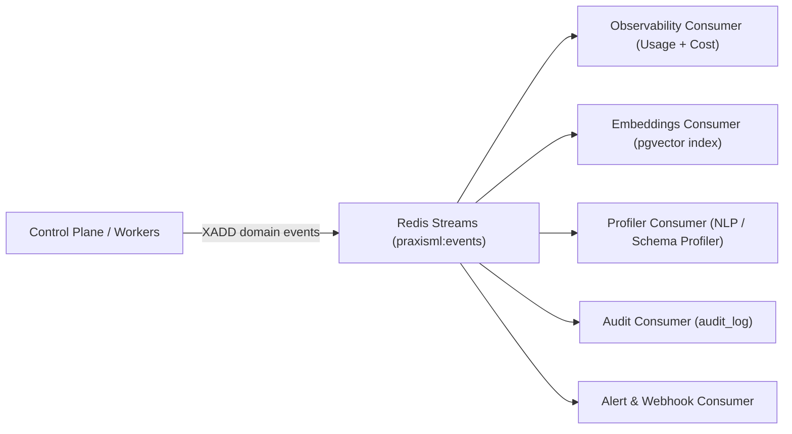

# Fase 2 — Modularización del Core, Compute Plane & Fundaciones Enterprise

> **Timeline:** Q2 2027 (Abril — Junio)  
> **Estado:** 🚧 Pendiente (Siguiente fase prioritaria)  
> **Carácter:** Refactorización estructural + separación Control Plane / Compute Plane + seguridad Enterprise  
> **Dependencias:** Fase 0 (Observabilidad) ✅ · Fase 1 (NLP Engine) ✅  
> 📖 **Documento maestro:** [roadmap.md](../roadmap.md)

---

## 1. Motivación y Problemas que Resuelve

Antes de incorporar un Lakehouse (Fase 3) o nuevas verticales pesadas como Computer Vision y Time Series (Fase 4), debemos eliminar los cuellos de botella detectados en el estado actual del repositorio:

1. **Duplicación entre dominios:** `training_service.py` (1,104 LOC) y `nlp_trainer.py` (518 LOC) no comparten contrato base; `worker/tasks/train.py` (262 LOC) y `train_nlp.py` (260 LOC) repiten la misma orquestación.
2. **Fat Routers y `services/` plano:** `models.py` (838 LOC), `datasets.py` (640 LOC), `observability.py` (611 LOC) y `streaming.py` (593 LOC) acoplan lógica HTTP, queries SQLAlchemy y llamadas a Storage/MLflow/DVC.
3. **Dependencias e imagen Docker monolíticas:** Un solo `pyproject.toml` obliga a que el API Gateway instale `torch`, `transformers`, `onnxruntime`, `shap`, `evidently`, etc.
4. **Cola Celery única (`task_routes = {}`) + `--pool=prefork`:** Un entrenamiento pesado bloquea inferencias y alertas; `prefork` + CUDA genera fallos en GPU.
5. **Acoplamientos impropios para escalado horizontal:** Subproceso `mlflow ui` en `main.py`, `Path(torchscript_path).exists()` en `inference_service.py` (incompatible con storage remoto puro), rate limit `slowapi` por IP en memoria y falta de PostgreSQL RLS / API Keys.
6. **Frontend monolítico:** `DashboardMVP.tsx` gestiona 11 vistas con `useState<View>` sin rutas reales Next.js App Router ni cambio real de tenant/workspace.

---

## 2. Arquitectura de Plugins y Contratos Unificados (Sub-fase 2.1)

Cada vertical ML (Tabular, NLP, CV, Time Series) pasa a implementarse como un **Plugin autocontenido** que cumple contratos estrictos y se registra automáticamente si sus dependencias opcionales están instaladas.

```python
# backend/app/plugins/contracts.py
from abc import ABC, abstractmethod
from dataclasses import dataclass, field
from typing import Any, Dict, List, Optional
from fastapi import APIRouter

@dataclass
class TrainingContext:
    tenant_id: str
    workspace_id: str
    dataset_ref: str                 # Storage key (F2) o Delta Table URI (F3)
    algorithm: str
    task_type: str
    hyperparams: Dict[str, Any]
    validation_config: Dict[str, Any]
    compute_profile: str = "cpu-light"  # cpu-light | cpu-heavy | gpu-train

@dataclass
class TrainingResult:
    mlflow_run_id: str
    metrics: Dict[str, float]
    artifact_keys: Dict[str, str]    # {"model": "...", "onnx": "...", "pipeline": "..."}
    duration_s: float
    framework: str
    metadata: Dict[str, Any] = field(default_factory=dict)

class BaseTrainer(ABC):
    domain: str
    @abstractmethod
    def supported_algorithms(self) -> Dict[str, Dict[str, Any]]: ...
    @abstractmethod
    def train(self, ctx: TrainingContext) -> TrainingResult: ...

class BaseInferenceEngine(ABC):
    domain: str
    @abstractmethod
    def load(self, model_record: Any, storage: Any) -> Any: ...
    @abstractmethod
    def predict(self, loaded_model: Any, payload: Any, **kwargs) -> Dict[str, Any]: ...

class DomainPlugin(ABC):
    name: str                        # "tabular" | "nlp" | "cv" | "timeseries"
    version: str
    required_extra: str              # "tabular" | "nlp" | "cv" | "ts"
    default_queue: str               # "cpu-heavy" | "gpu-train"

    @abstractmethod
    def get_routers(self) -> List[tuple[APIRouter, str, List[str]]]: ...
    @abstractmethod
    def get_trainer(self) -> BaseTrainer: ...
    @abstractmethod
    def get_inference_engine(self) -> BaseInferenceEngine: ...
    def get_profiler(self) -> Optional[Any]: return None
    def get_copilot_tools(self) -> List[Any]: return []  # Registro dinámico de acciones para el Platform Copilot
    def register_event_handlers(self, bus: Any) -> None: ...
```

### Base del `CopilotToolRegistry` (Transversal desde Fase 2)
- Promover el asistente fuera de `/api/v1/nlp/assistant/*` hacia `/api/v1/copilot/*` (manteniendo alias de compatibilidad) para prepararlo como agente transversal de toda la plataforma.
- Definir `CopilotToolRegistry` y el contrato `CopilotTool` (con `min_role` y `risk_tier` 0–3) para que cada plugin (`tabular`, `nlp` y futuros `cv`/`ts`) y cada módulo de plataforma exponga sus acciones sin acoplamiento central.
- Corregir el bug actual en `backend/app/api/routes/v1/nlp/assistant.py` (línea 127), donde el modo SSE guarda `"«respuesta streamed»"` en lugar de acumular y persistir el texto completo generado.

### Unificación de la Tubería de Entrenamiento
En lugar de mantener `train.py`, `train_nlp.py`, `train_cv.py`, `train_ts.py` duplicados, existirá un orquestador único `run_domain_training(domain, ctx)`:
1. Resuelve el plugin vía `PluginRegistry.get(domain)`.
2. Verifica estado del dataset/workspace y ejecuta `trainer.train(ctx)`.
3. Registra `MLModel` y versión en MLflow Registry de forma uniforme.
4. Emite el evento `model.trained` en el Event Bus → suscriptores independientes ejecutan `UsageCollector`, `CostCalculator`, `EmbeddingService.index_model` y `AuditService`.

---

## 3. Refactorización Interna & Dependencias Modulares (Sub-fase 2.2)

### División de `pyproject.toml` en Extras Opcionales

```toml
[project]
name = "praxisml-backend"
dependencies = [
    # Core ligero del Control Plane (sin torch ni transformers)
    "fastapi>=0.133.1", "uvicorn>=0.41.0", "sqlalchemy>=2.0.47", "alembic>=1.18.4",
    "psycopg2-binary>=2.9.11", "pydantic>=2.12.5", "pydantic-settings>=2.13.1",
    "redis>=7.2.1", "celery>=5.6.2", "boto3>=1.34.0", "mlflow==3.10.0",
    "prometheus-fastapi-instrumentator>=7.0.0", "slowapi>=0.1.9", "pyjwt>=2.11.0",
    "passlib[bcrypt]>=1.7.4", "reportlab>=4.2,<5", "pgvector>=0.5.0",
]

[project.optional-dependencies]
tabular   = ["scikit-learn>=1.3", "pandas>=2.0", "pyarrow>=14.0", "openpyxl>=3.1", "shap>=0.44", "evidently>=0.4", "joblib>=1.3"]
pytorch   = ["torch>=2.0", "torchvision>=0.15"]
nlp       = ["transformers>=4.46,<5", "datasets>=5.0", "sentence-transformers>=5.7", "onnxruntime>=1.17,<1.22", "onnx>=1.16,<1.18", "seqeval>=1.2", "langdetect>=1.0", "openai>=2.53", "accelerate>=0.26"]
lakehouse = ["deltalake>=0.22", "duckdb>=1.1", "polars>=1.10", "openlineage-python>=1.24"]
cv        = ["ultralytics>=8.3", "albumentations>=1.4", "python-doctr>=0.9"]
ts        = ["statsforecast>=1.7", "mlforecast>=0.13", "neuralforecast>=1.7"]
serving   = ["ray[serve]>=2.38"]
```

### Imágenes Docker Multi-Perfil (`backend/docker/`)
| Imagen | Extras instalados | Tamaño objetivo | Uso |
|---|---|---|---|
| `praxisml-api` | Solo Core + `openai` + `pgvector` | ~350 MB | Control Plane FastAPI stateless (escalable horizontalmente) |
| `praxisml-worker-cpu` | Core + `tabular` + `lakehouse` + `ts` | ~1.2 GB | Entrenamiento Sklearn/TS, profiling, drift, ETL |
| `praxisml-worker-gpu` | Core + `pytorch` + `nlp` + `cv` (base CUDA) | ~4–5 GB | Fine-tuning Transformers, PyTorch MLP, CV, ONNX export |
| `praxisml-beat` | Solo Core | ~300 MB | Scheduler periódico sin dependencias ML |

### Descomposición de *Fat Routers*
- `api/routes/v1/models.py` (838 LOC) → Router fino + `services/model_registry_service.py` + `repositories/model_repo.py`.
- `api/routes/v1/datasets.py` (640 LOC) → Router fino + `services/dataset_service.py` + `repositories/dataset_repo.py`.
- `services/training_service.py` (1,104 LOC) → `plugins/tabular/sklearn_trainer.py` + `plugins/tabular/pytorch_trainer.py`.
- `api/routes/v1/observability.py` (611 LOC) → Delegación de agregaciones SQL a `platform/observability/queries.py`.

---

## 4. Event Bus Interno — Redis Streams (Sub-fase 2.3)



- **Eventos core iniciales:** `dataset.uploaded`, `dataset.deleted`, `model.trained`, `model.promoted`, `model.archived`, `prediction.completed`, `drift.detected`, `quota.exceeded`, `auth.key_created`.
- **Beneficio:** Si `EmbeddingService` o `NLPProfiler` fallan o tardan, no bloquean `POST /datasets/` ni un job de entrenamiento; los consumidores usan *consumer groups* con reintentos y Dead-Letter Queue (`praxisml:events:dlq`).

---

## 5. Separación Control Plane vs. Compute Plane (Sub-fase 2.4)

### Enrutamiento de Colas Tipadas

```python
# backend/app/worker/celery_app.py (objetivo)
celery_app.conf.task_routes = {
    "app.worker.tasks.scheduled_checks.*": {"queue": "system-beat"},
    "app.worker.tasks.profiling.*":        {"queue": "cpu-light"},
    "app.worker.tasks.predict.*":          {"queue": "cpu-heavy"},
    "app.worker.tasks.train_tabular.*":    {"queue": "cpu-heavy"},
    "app.worker.tasks.train_nlp.*":        {"queue": "gpu-train"},
    "app.worker.tasks.train_cv.*":         {"queue": "gpu-train"},
}
```

- Workers GPU arrancan con `--pool=solo --queues=gpu-train` (evitando errores de `fork()` con CUDA) y `concurrency=1` por GPU física.
- **Abstracción `ComputeBackend`:** Interfaz `submit_job(spec) -> JobHandle`, `get_status(handle)`, `cancel(handle)`, `stream_logs(handle)`.
  - Implementación 1 (Fase 2): `CeleryComputeBackend` (Docker Compose / despliegues ligeros).
  - Implementación 2 (Fases 3–4): `RayComputeBackend` / `KubernetesJobBackend` (escalado multi-nodo).
- **Correcciones obligatorias de statelessness:**
  - Eliminar `_start_mlflow_ui()` de `app/main.py` (en dev se usa `docker compose up mlflow` o un script CLI explícito).
  - Corregir `InferenceService.load_model()` para descargar artefactos `.pt`/ONNX vía `StorageService` a un directorio temporal cacheado por hash en lugar de asumir `Path(torchscript_path).exists()` en disco local.

---

## 6. Fundaciones Enterprise: Workspaces, RLS, PATs y Audit Log (Sub-fase 2.5)

### Nueva Jerarquía de Aislamiento
`Tenant (Organización)` → `Workspace (Proyecto / Equipo)` → `Environment (dev | staging | prod)` → Recursos (`Dataset`, `MLModel`, `Workflow`, `ServingEndpoint`).

### Tablas Nuevas (Migración Alembic `phase2_enterprise_core`)
1. **`workspaces`**: `(id, tenant_id, name, slug, environment, default_compute_profile, budget_limit_usd, created_at)` — se crea un workspace `default` automáticamente al migrar tenants existentes (100% retrocompatible).
2. **`api_keys` (Service Principals / PATs)**: `(id, tenant_id, workspace_id, user_id, name, key_prefix, key_hash_sha256, scopes JSONB, expires_at, last_used_at, revoked_at)` — habilita autenticación M2M para SDK, CLI, Notebooks, CI/CD y Model Serving.
3. **`audit_log` (adelantado desde Fase 4)**: `(id, tenant_id, workspace_id, actor_id, actor_type [user|api_key|system|copilot], action, resource_type, resource_id, metadata JSONB, ip_address, request_id, created_at)` — tabla append-only indexada por `(tenant_id, created_at DESC)`.

### Seguridad Reforzada
- **PostgreSQL Row-Level Security (RLS):** Middleware SQLAlchemy que ejecuta `SET LOCAL app.current_tenant_id = :tid` al abrir cada transacción en Postgres, respaldado por políticas `CREATE POLICY tenant_isolation ON <table> USING (tenant_id = current_setting('app.current_tenant_id', true))`. Defensa en profundidad frente a olvidos de `.filter(tenant_id=...)`.
- **Rate Limiting distribuido:** Migrar `slowapi` a backend `storage_uri=settings.REDIS_URL` con función `key_func` basada en `tenant_id` (o `api_key_id`) en lugar de IP del proxy.

---

## 7. Modernización Frontend & Higiene del Repositorio (Sub-fase 2.6)

### Frontend (`frontend/frontend/`)
- Migrar `DashboardMVP.tsx` (estado `useState<View>`) a rutas reales de **Next.js App Router**:
  - `/workspaces/[workspaceId]/datasets`
  - `/workspaces/[workspaceId]/models`
  - `/workspaces/[workspaceId]/training`
  - `/workspaces/[workspaceId]/nlp`
  - `/workspaces/[workspaceId]/observability`
  - `/workspaces/[workspaceId]/settings/api-keys` y `/audit`
- Implementar cambio real de **Tenant / Workspace** (renovando contexto/token sin `alert()`).
- Introducir **TanStack Query (React Query)** para unificar caché, reintentos y polling inteligente en lugar de `useEffect` + `setInterval` dispersos.

### Higiene Técnica y Calidad
- Limpiar y añadir a `.gitignore` ficheros locales temporales (`backend/test_*.db`, `backend/mlflow.db`, `backend/mlruns/`, `backend/data/tenants/*`).
- Revisar y documentar una política estricta de migraciones Alembic (evitar revisiones duplicadas; check `alembic check` en CI).
- Subir umbral de cobertura en `.github/workflows/ci.yml` de 50% a **≥70%**.

---

## 8. Riesgos y Mitigaciones

| Riesgo | Mitigación |
|---|---|
| **Regresiones en endpoints existentes durante la refactorización** | Mantener la suite actual de tests de integración + tests de contratos API en cada PR; migración incremental dominio a dominio (Tabular primero, NLP después). |
| **RLS incompatible con SQLite en tests unitarios** | Aplicar políticas RLS solo cuando el dialecto SQLAlchemy es `postgresql`, con una suite de integración dedicada sobre Postgres en CI. |
| **Sobrecarga operativa por múltiples imágenes Docker** | Usar un único `Dockerfile` multi-stage con `--build-arg PROFILE=api|cpu|gpu` para evitar duplicar Dockerfiles. |

---

> [← Fase 1 — NLP Engine](phase-1-nlp.md) · [Volver al Roadmap principal](../roadmap.md) · [Siguiente: Fase 3 — Data Lakehouse, Catalog & Workflows →](phase-3-lakehouse-catalog-workflows.md)
