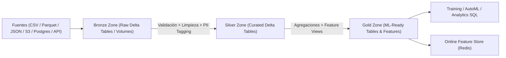

# Fase 3 — Data Lakehouse, Praxis Catalog, Workflows & Feature Store

> **Timeline:** Q3 2027 (Julio — Septiembre)  
> **Estado:** 📐 Planificada  
> **Carácter:** Transformación de la capa de datos y orquestación hacia el modelo **Lakehouse estilo Databricks**  
> **Dependencias:** Fase 2 (Plugin Architecture, ComputeBackend, Workspaces, RLS, Event Bus)  
> 📖 **Documento maestro:** [roadmap.md](../roadmap.md)

---

## 1. Visión General

Esta es la fase que transforma a PraxisML de un *gestor de archivos + lanzador de modelos* a una **plataforma Lakehouse unificada**:

1. **Medallion Lakehouse (Bronze / Silver / Gold):** Datos tabulares almacenados como tablas ACID **Delta Lake (`deltalake-rs`)** sobre MinIO/S3 y procesados fuera de memoria (*out-of-core*) con **DuckDB + Polars**, eliminando el límite de RAM de `pandas` y el acoplamiento de `DVCService` al disco local.
2. **Praxis Catalog (estilo Unity Catalog):** Catálogo único de 3 niveles (`workspace.schema.asset`) que unifica Tablas, Volúmenes, Features, Modelos y Prompts con **OpenLineage** y ACLs granulares.
3. **Praxis Workflows (estilo Lakeflow Jobs):** Motor de pipelines declarativos (DAGs) para automatizar de punta a punta ingesta, transformación, feature engineering, entrenamiento, evaluación y scoring batch.
4. **Praxis Feature Store:** Reutilización de features versionadas con paridad Offline (Delta) / Online (Redis) y *point-in-time joins*.

---

## 2. Medallion Lakehouse & `DataEngine` (Sub-fase 3.1)

### Transición desde el Modelo Actual
- **Hoy:** `storage.download(key)` → `BytesIO` completo en RAM → `pandas.read_csv()` + `DVCService` lanzando `subprocess(["dvc", ...])` en disco local.
- **Objetivo:** Ingesta directa en **Object Storage (MinIO/S3)** como tablas **Delta Lake** con transacciones ACID, *Time Travel* (`VERSION AS OF N`), *Schema Evolution* y lectura lazy/streaming mediante **DuckDB** y **Polars**.



### Contrato `DataEngine` (Multi-Motor Extensible)
```python
# backend/app/platform/lakehouse/engine.py
class DataEngine(ABC):
    """Permite usar DuckDB/Polars en despliegues ligeros y Spark/Ray Data a gran escala."""
    @abstractmethod
    def query_sql(self, workspace_id: str, sql: str, limit: int = 1000) -> Dict[str, Any]: ...
    @abstractmethod
    def read_table(self, table_uri: str, version: Optional[int] = None, columns: Optional[List[str]] = None) -> Any: ...
    @abstractmethod
    def write_table(self, data: Any, table_uri: str, mode: str = "append", partition_by: Optional[List[str]] = None) -> TableCommitInfo: ...
    @abstractmethod
    def get_history(self, table_uri: str) -> List[Dict[str, Any]]: ...
```

- **Implementación default:** `DuckDBPolarsDeltaEngine` (`deltalake` + `duckdb` + `polars`) — cero JVM, arranca en milisegundos, procesa decenas de GB en una sola máquina haciendo *predicate pushdown* sobre Parquet/Delta en MinIO/S3.
- **Extensión Big Data:** `RayDataEngine` o `SparkConnectEngine` enchufables por perfil de compute sin cambiar el código de negocio ni el catálogo.
- **Rol de DVC:** `DVCService` deja de ser obligatorio para datos tabulares (reemplazado por Time Travel nativo de Delta Lake sin estado local) y queda como adaptador opcional de importación/sincronización con repositorios Git/DVC externos.

---

## 3. Praxis Catalog & OpenLineage — Estilo Unity Catalog (Sub-fase 3.2)

### Jerarquía de 3 Niveles
```text
<workspace_slug>.<schema_name>.<asset_name>
Ejemplos:
  fraud_prod.bronze.transactions_raw          (Delta Table)
  fraud_prod.silver.transactions_clean        (Delta Table)
  fraud_prod.gold.customer_risk_features      (Feature View / Table)
  fraud_prod.volumes.medical_mri_scans        (Volume — imágenes/PDFs/ZIPs)
  fraud_prod.models.fraud_classifier          (MLModel → MLflow Registry)
  fraud_prod.prompts.rag_system_prompt        (Prompt versionado)
```

### Modelo de Datos del Catálogo (`platform/catalog/`)
- **`catalog_schemas`**: `(id, tenant_id, workspace_id, name, zone [bronze|silver|gold|custom], description, owner_id)`
- **`catalog_assets`**: `(id, tenant_id, workspace_id, schema_id, name, asset_type [table|volume|feature_view|model|prompt], storage_uri, current_version, schema_json, tags JSONB, pii_columns JSONB, created_at, updated_at)`
- **`catalog_grants` (ACLs granulares)**: `(id, tenant_id, asset_id, principal_type [user|role|api_key], principal_id, privileges [SELECT|MODIFY|EXECUTE|MANAGE], column_mask_rules JSONB)`
- **`lineage_edges` (OpenLineage)**: `(id, tenant_id, workspace_id, source_asset_id, source_version, target_asset_id, target_version, transformation_type [sql|workflow_task|training|feature_materialization], run_id, recorded_at)`

### Capacidades Clave
- **Linaje end-to-end consultable en UI y API:** Desde cualquier modelo en producción se puede rastrear exactamente qué versión de tabla Bronze → transformación Silver → Feature View → MLflow Run → predicciones generó un resultado.
- **Detección y Enmascaramiento PII:** Etiquetado automático de columnas sensibles (`email`, `dni`, `phone`, `iban`) al ingerir a Bronze/Silver, con enmascaramiento dinámico para usuarios `viewer` sin privilegio `UNMASK`.
- **Sincronización bidireccional con MLflow Registry:** Todo modelo registrado en MLflow aparece automáticamente como activo de primer nivel en Praxis Catalog bajo `<workspace>.models.<name>`.

---

## 4. Praxis Workflows — Orquestador de DAGs (Sub-fase 3.3)

Sustituye la ejecución manual paso a paso por **pipelines declarativos reproducibles** (equivalente a Databricks Workflows / Lakeflow Jobs).

### Ejemplo de Definición Declarativa (`workflow.yaml` / JSON API)
```yaml
name: daily_churn_pipeline
workspace: retail_prod
schedule: "0 2 * * *"                  # Cron o trigger por evento ("table.updated:retail_prod.bronze.events")
retry_policy:
  max_retries: 2
  backoff_seconds: 60
tasks:
  - id: clean_events
    type: sql_transform
    compute_profile: cpu-light
    sql: "SELECT * FROM retail_prod.bronze.events WHERE amount > 0"
    output_table: retail_prod.silver.events_clean
    write_mode: overwrite

  - id: materialize_features
    type: feature_materialize
    depends_on: [clean_events]
    feature_view: retail_prod.gold.customer_churn_features
    sync_online: true

  - id: train_candidate
    type: plugin_train
    depends_on: [materialize_features]
    domain: tabular
    algorithm: gradient_boosting
    compute_profile: cpu-heavy
    dataset: retail_prod.gold.customer_churn_features
    target_column: churned

  - id: evaluate_and_promote
    type: model_gate
    depends_on: [train_candidate]
    min_f1: 0.85
    promote_stage: Staging
```

### Arquitectura del Motor de Workflows
- **Tablas ORM:** `workflow_definitions` (versionadas), `workflow_runs` (estado global, duración, coste agregado FinOps), `workflow_task_runs` (estado por nodo, logs, `compute_job_id`, métricas).
- **Tipos de nodo soportados:** `ingest`, `sql_transform`, `python_script`, `data_quality`, `feature_materialize`, `plugin_train`, `batch_inference`, `model_gate`, `webhook_notify`.
- **Backend de ejecución desacoplado (`WorkflowExecutor`):** Implementación inicial nativa sobre `ComputeBackend` (Celery/Ray + grafo topológico en Postgres/Redis) con adaptador opcional para **Temporal** o **Prefect** en despliegues de muy alta escala.
- **Observabilidad integrada:** Cada `workflow_run` consolida costes de todas sus tareas en `CostCalculator` y emite eventos de linaje automáticamente a `lineage_edges`.

---

## 5. Praxis Feature Store — Offline + Online (Sub-fase 3.4)

### Problema que Resuelve
Actualmente `ColumnTransformer` se serializa como `.joblib` acoplado a un único dataset/modelo, provocando duplicación de lógica y *training-serving skew*.

### Arquitectura Dual
- **Offline Store:** Tablas Delta en la zona Gold (`<workspace>.gold.<feature_view>`) con columna `entity_id` + `event_timestamp` para **point-in-time joins** (evita *data leakage* temporal al generar datasets de entrenamiento).
- **Online Store:** Hash/JSON en **Redis** (`fs:{tenant_id}:{feature_view}:{entity_id}`) con TTL configurable para lecturas <5 ms durante la inferencia en tiempo real (Fase 4 Serving).
- **Transformaciones compartidas:** Definidas una sola vez en SQL (DuckDB) o Python (Polars) y registradas en Praxis Catalog con linaje y dueño.

---

## 6. Integración con el Platform Copilot (Tools Lakehouse & Workflows)

Todos los módulos introducidos en Fase 3 registran automáticamente sus herramientas en el `CopilotToolRegistry` (creado en Fase 2):
- **Catalog & Lineage (Tier 0):** `catalog.search_assets`, `catalog.describe_table`, `catalog.get_lineage`, `catalog.get_table_history`.
- **SQL & Data Quality (Tier 1):** `lakehouse.run_sql_readonly` (ejecución DuckDB en sandbox con `LIMIT`, RLS y enmascaramiento PII — habilita Text-to-SQL gobernado estilo *Databricks Genie*).
- **Transformaciones, Features & DAGs (Tier 2):** `lakehouse.create_derived_table`, `features.create_view`, `features.materialize`, `workflows.create_or_update`, `workflows.trigger_run`, `workflows.get_task_logs` (diagnóstico asistido de fallos).
- **Governance destructiva (Tier 3 — aprobación humana):** `catalog.update_grants`, `catalog.drop_table`.

---

## 7. Endpoints API de Fase 3

| Grupo | Método | Path | Descripción |
|---|---|---|---|
| **Catalog** | `GET/POST` | `/api/v1/catalog/schemas` | Gestionar esquemas Bronze/Silver/Gold |
| **Catalog** | `GET/POST` | `/api/v1/catalog/tables` | Listar/crear tablas Delta y consultar schema |
| **Catalog** | `GET` | `/api/v1/catalog/tables/{fqn}/history` | Historial de versiones (Time Travel) |
| **Catalog** | `POST` | `/api/v1/catalog/sql/query` | Ejecutar consulta SQL segura (DuckDB + RLS/ACLs) |
| **Catalog** | `GET` | `/api/v1/catalog/lineage/{asset_id}` | Grafo upstream/downstream (OpenLineage) |
| **Catalog** | `PUT` | `/api/v1/catalog/grants/{asset_id}` | Configurar ACLs y reglas PII |
| **Workflows** | `GET/POST` | `/api/v1/workflows/` | Crear y versionar DAGs declarativos |
| **Workflows** | `POST` | `/api/v1/workflows/{id}/trigger` | Disparar ejecución manual o backfill |
| **Workflows** | `GET` | `/api/v1/workflows/runs/{run_id}` | Estado por nodo, logs y coste agregado |
| **Features** | `GET/POST` | `/api/v1/features/views` | Definir Feature Views (SQL/Polars) |
| **Features** | `POST` | `/api/v1/features/views/{id}/materialize` | Materializar Offline (Delta) y Online (Redis) |
| **Features** | `POST` | `/api/v1/features/online/lookup` | Lectura de baja latencia por `entity_id` |

---

## 8. Riesgos y Mitigaciones

| Riesgo | Mitigación |
|---|---|
| **Consultas SQL maliciosas o sin límite en DuckDB** | Ejecutar DuckDB en modo sandbox (sin acceso a filesystem local del contenedor), resolver rutas S3 solo desde Praxis Catalog con credenciales temporales por tenant, aplicar `LIMIT` y timeout estricto de memoria/CPU por query. |
| **Escrituras concurrentes en tablas Delta** | `deltalake-rs` soporta concurrencia optimista sobre S3/MinIO mediante DynamoDB/locking o lock ligero en Redis/Postgres por `table_uri`. |
| **Complejidad para usuarios No-Code existentes** | Mantener la subida simple de CSV/Parquet en la UI: internamente el backend ingesta automáticamente a `<workspace>.bronze.<dataset>` sin obligar al usuario a escribir SQL. |
| **Tamaño del Online Feature Store en Redis** | Políticas explícitas de TTL, eviction controlada por namespace y cuota de memoria Redis por tenant. |

---

> [← Fase 2 — Core Modular & Compute Plane](phase-2-modular-core-compute.md) · [Volver al Roadmap principal](../roadmap.md) · [Siguiente: Fase 4 — Serving, Workspace & Verticales CV/TS →](phase-4-serving-workspace-verticals.md)
