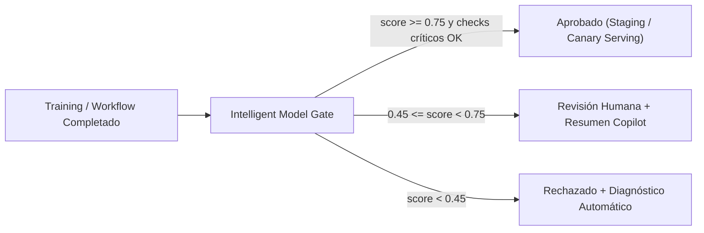
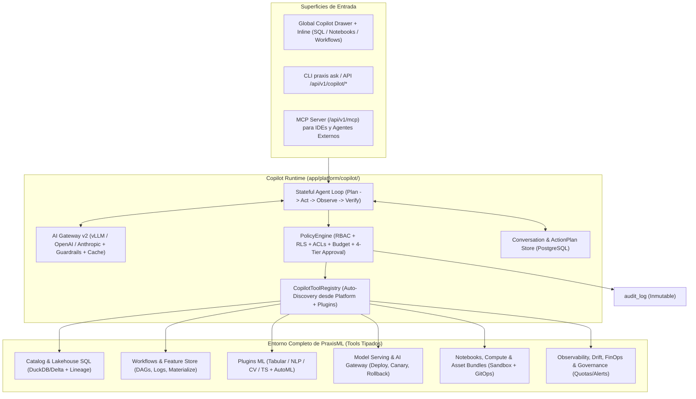

# Fase 5 (Parte B) — AI-Powered DevOps, Full-Environment Agentic Copilot & Cloud-Native Scale

> **Timeline:** Q1–Q2 2028 (Marzo — Junio) — Sub-fases **5.3 (Intelligent Gate & AI Tests)**, **5.4 (Full-Environment Agentic Copilot & MCP)** y **5.5 (Resource Optimization, Kubernetes & BYOC)**  
> **Carácter:** Automatización inteligente del ciclo de vida ML + Agente transversal con acciones sobre todo el entorno + escalado enterprise Cloud-Native  
> **Dependencias:** Fase 0 ✅ · Fase 1 ✅ · Fase 2 (`DomainPlugin`, `CopilotToolRegistry`, `audit_log`, RLS, PATs, `ComputeBackend`) · Fase 3 (Lakehouse, Catalog, OpenLineage, Workflows, Feature Store) · Fase 4 (Model Serving, AI Gateway v2, Notebooks, SDK/Asset Bundles)  
> 📖 **Documentos de referencia:** [roadmap.md](../roadmap.md) · [Fase 5 (Parte A) — Smart Platform](phase-3-smart-platform.md)

---

## Índice

- [Visión General](#visión-general)
- [5.3a — AI-Generated Tests](#53a--ai-generated-tests)
- [5.3b — Intelligent Model Gate (CI/CD)](#53b--intelligent-model-gate-cicd)
- [5.4 — Full-Environment Agentic Platform Copilot & MCP](#54--full-environment-agentic-platform-copilot--mcp)
- [5.5a — Cost & Resource Optimization](#55a--cost--resource-optimization)
- [5.5b — Cloud-Native Scale, Kubernetes & BYOC](#55b--cloud-native-scale-kubernetes--byoc)
- [Stack Tecnológico](#stack-tecnológico)
- [Impacto en la Arquitectura](#impacto-en-la-arquitectura)
- [API Endpoints](#api-endpoints)
- [Riesgos y Mitigaciones](#riesgos-y-mitigaciones)
- [Plan de Implementación](#plan-de-implementación)

---

## Visión General

Cerrar el ciclo de madurez de la plataforma transformando PraxisML en un sistema **proactivo, operable por agente de extremo a extremo y escalable en la nube**:

1. **AI-Generated Tests (5.3a):** Generación asistida de tests unitarios e integración en PRs sobre **AI Gateway v2**.
2. **Intelligent Model Gate (5.3b):** Promoción automatizada holística combinando métricas MLflow, drift de Inference Tables, latencia Serving, fairness (`fairlearn`), coste FinOps y linaje OpenLineage.
3. **Full-Environment Agentic Copilot & MCP (5.4):** Evolución del asistente solo-lectura de Fase 1 hacia un **agente transversal con acceso gobernado a todo el entorno** (Lakehouse SQL, Praxis Catalog, Workflows, Feature Store, Training multi-dominio, Model Serving, Notebooks, Asset Bundles, Observabilidad y Administración), con **Tool Registry dinámico por plugins**, **PolicyEngine de 4 niveles con Human-in-the-Loop** y exposición **MCP (Model Context Protocol)**.
4. **Resource Optimization & Cloud-Native Scale (5.5):** Predicción de carga, autoscaling por colas/GPU con **Kubernetes + Helm + KEDA**, Terraform y arquitectura opcional **BYOC (Bring Your Own Cloud)**.

---

## 5.3a — AI-Generated Tests

**Punto de entrada:** `.github/workflows/ci.yml` + nuevo `.github/workflows/ai_tests.yml`

Usa **AI Gateway v2** (con el proveedor configurado por la organización, sin hardcodear un único modelo comercial) para:
1. Detectar archivos modificados en el PR (`backend/app/plugins/**`, `backend/app/platform/**`).
2. Extraer firmas, tipos, contratos y docstrings (sin enviar datos de producción).
3. Generar tests siguiendo las convenciones de `backend/tests/` como *few-shot examples*.
4. Validar automáticamente los tests generados antes de comentarlos en el PR (nunca auto-merge).

| Señal de Calidad | Evaluador | Threshold |
|---|---|---|
| Cobertura de líneas nuevas | `pytest --cov` | ≥ 80% |
| Estabilidad (no flaky) | Ejecución 3x consecutivas | 100% pass |
| Sin sobre-mocking | Análisis AST | < 50% asserts sobre mocks |
| Estilo y tipado | `ruff check` | 0 errores |

---

## 5.3b — Intelligent Model Gate (CI/CD)

**Punto de entrada:** `.github/workflows/model_ci.yml` + `backend/scripts/intelligent_gate.py` + nodo `model_gate` de **Praxis Workflows** (Fase 3.3).

Combina señales de toda la plataforma en un score ponderado auditable:

| Señal | Fuente en PraxisML | Peso |
|---|---|---|
| **Performance** (F1 / RMSE / IoU / MASE) | MLflow Run Metrics | 35% |
| **Data & Prediction Drift** | Inference Tables (Delta) + `drift_history` | 20% |
| **Latencia Serving (p95)** | Dedicated Model Serving Plane (Fase 4.1) | 15% |
| **Fairness / Bias** | `fairlearn` (demographic parity / equalized odds) | 10% |
| **Linaje & Data Quality** | Praxis Catalog + OpenLineage (sin errores Bronze→Gold) | 10% |
| **Coste FinOps estimado** | `CostCalculator` vs. `workspace.budget_limit_usd` | 10% |



---

## 5.4 — Full-Environment Agentic Platform Copilot & MCP

### Diagnóstico del Asistente de Fase 1 vs. Agente de Entorno Completo

En Fase 1 (`app/api/routes/v1/nlp/assistant.py` + `rag_service.py`), el asistente vive dentro de la vertical NLP, inyecta un snapshot estático limitado (20 modelos, 10 drifts, 10 costes), no puede ejecutar acciones y tiene un bug conocido en modo SSE (persiste `"«respuesta streamed»"` en lugar del texto completo).

En la arquitectura v2.0, el Copilot se promueve a **módulo transversal del Control Plane (`app/platform/copilot/`)** que evoluciona incrementalmente desde Fase 2 hasta Fase 5:
- **Fase 2:** Contrato `CopilotTool` en `DomainPlugin`, `CopilotToolRegistry`, promoción a `/api/v1/copilot/*`, conexión a `audit_log` + RLS y corrección de persistencia SSE.
- **Fase 3:** Registro automático de tools de **Catalog, Lineage, DuckDB SQL Read-Only, Workflows y Feature Store**.
- **Fase 4:** Conexión a **AI Gateway v2** (guardrails, Prompt Registry, semantic cache), **Inline Copilot** en SQL Explorer y Notebooks, tools de **Serving/CV/Time Series** y servidor **MCP**.
- **Fase 5 (esta sub-fase):** **Orquestador Agéntico Multi-Paso completo** con planificación, checkpoints, aprobación Human-in-the-Loop en UI, remediación asistida de incidentes y generación de Asset Bundles.

### Arquitectura del Agente de Entorno Completo



### Descubrimiento Modular de Tools (Sin Lista Hardcodeada)

Cada módulo de plataforma (`catalog`, `lakehouse`, `workflows`, `feature_store`, `serving`, `notebooks`, `observability`, `admin`) y cada `DomainPlugin` instalado (`tabular`, `nlp`, `cv`, `timeseries`) registra sus propios tools tipados al arrancar:

```python
# backend/app/platform/copilot/contracts.py
from dataclasses import dataclass
from enum import IntEnum
from typing import Any, Callable, Dict, Type
from pydantic import BaseModel

class ActionRiskTier(IntEnum):
    READ_METADATA = 0      # Lectura de metadatos/estado -> auto-ejecutable
    SAFE_COMPUTE  = 1      # SQL read-only sandbox, dry-run, estimaciones -> auto-ejecutable con límites
    MUTATE_DEV    = 2      # Crear/ejecutar en dev/staging -> pre-flight cost check (confirma si supera umbral)
    CRITICAL_PROD = 3      # Producción, borrados, permisos, cuotas -> aprobación humana obligatoria

@dataclass
class CopilotTool:
    name: str                          # e.g. "lakehouse.run_sql_readonly"
    namespace: str                     # catalog | lakehouse | workflows | training | serving | notebooks | observability | admin
    description: str
    args_schema: Type[BaseModel]
    handler: Callable[..., Any]
    min_role: str                      # viewer | editor | admin
    risk_tier: ActionRiskTier
    prod_requires_approval: bool = True
    cost_estimator: Callable[..., float] | None = None
```

### Matriz de Acciones sobre Todo el Entorno

| Capa del Entorno | Tools Disponibles | Rol Mínimo | Tier de Riesgo |
|---|---|---|---|
| **Catalog & Lakehouse** | `catalog.search_assets`, `catalog.describe_table`, `catalog.get_lineage`, `catalog.get_table_history` | `viewer` | Tier 0 |
| **SQL & Data Quality** | `lakehouse.run_sql_readonly` (sandbox + `LIMIT 100` + PII masking), `lakehouse.profile_table`, `lakehouse.check_quality` | `viewer` | Tier 1 |
| **Transformaciones** | `lakehouse.create_derived_table` (Bronze→Silver/Gold), `features.create_view`, `features.materialize` | `editor` | Tier 2 |
| **Training & AutoML (Multi-Dominio)** | `training.list_algorithms`, `training.recommend`, `training.submit_job`, `training.cancel_job`, `automl.submit_experiment` | `editor` | Tier 0–2 |
| **Workflows (DAGs)** | `workflows.list`, `workflows.inspect_run`, `workflows.get_task_logs`, `workflows.create_or_update`, `workflows.trigger_run` | `viewer`/`editor` | Tier 0–2 |
| **Model Registry & Serving** | `models.compare_runs`, `models.evaluate_gate`, `serving.get_metrics` | `viewer` | Tier 0–1 |
| **Despliegues & Tráfico** | `models.promote_stage`, `models.archive`, `serving.deploy_endpoint`, `serving.update_traffic_split` (Canary/A-B/Rollback) | `editor`/`admin` | **Tier 3** |
| **Notebooks, Compute & GitOps** | `notebooks.generate`, `notebooks.run_sandbox_snippet`, `compute.inspect_queues`, `bundles.generate`, `bundles.validate` | `editor` | Tier 1–2 |
| **Observability & Drift** | `observability.get_usage`, `observability.get_costs`, `observability.get_forecast`, `drift.check`, `drift.forecast`, `alerts.create` | `viewer`/`editor` | Tier 0–2 |
| **Governance & Admin** | `catalog.update_grants`, `catalog.drop_table`, `drift.update_thresholds`, `admin.update_quotas`, `admin.revoke_api_key` | `admin` | **Tier 3** |

### Seguridad, Privacidad y Gobierno (Zero-Privilege Elevation)

| Mecanismo | Diseño Técnico |
|---|---|
| **Propagación estricta de identidad** | El agente **nunca** corre con credenciales de superusuario. Cada tool recibe el `ExecutionIdentity` del usuario autenticado (JWT/PAT, rol RBAC, `workspace_id`, contexto **PostgreSQL RLS** y ACLs de **Praxis Catalog**). |
| **4-Tier PolicyEngine + Human-in-the-Loop** | Acciones Tier 3 (o Tier 2 cuyo coste estimado supere el umbral del workspace o afecten a `env=prod`) pausan el bucle agéntico, persisten un `CopilotActionPlan` (`PENDING_APPROVAL`, con diff, impacto de linaje y coste estimado USD) y requieren confirmación explícita vía UI o API (`POST /api/v1/copilot/actions/{id}/approve`). |
| **Política de Acceso a Datos Configurable** | Dos modos por workspace: **(1) `strict_metadata_only` (default)** — el agente solo inspecciona esquemas, estadísticas agregadas, logs y metadatos, nunca filas crudas; **(2) `governed_analyst` (opt-in)** — permite SQL analítico/previews limitados con enmascaramiento automático de columnas PII del catálogo y restricción opcional a LLM self-hosted (`vLLM`). |
| **Defensa contra Indirect Prompt Injection** | Todos los outputs de tools (logs de tareas, nombres de columnas, celdas de texto, mensajes de error) pasan por sanitización y marcadores de datos no confiables + guardrails de **AI Gateway v2** antes de volver al modelo; además `PolicyEngine` valida argumentos con Pydantic en el servidor independientemente de lo que genere el LLM. |
| **Límites de Ejecución y FinOps** | `max_steps=10`, timeout total configurable, verificación previa de `budget_remaining` en `CostCalculator`, y registro completo en `audit_log` (`actor_type="copilot"`, `delegated_by=user_id`, parámetros, decisión de política, coste y resultado). |

### Ejemplo End-to-End en el Entorno Completo

> **Usuario:** *"El endpoint `churn-live` subió su drift ayer. Investiga qué tabla lo causó, crea un workflow de reentrenamiento en `staging` con el mejor algoritmo recomendado y prepara un despliegue Canary al 10%."*  
> **Copilot (streaming SSE de pasos):**
> 1. `[Tier 0]` `serving.get_metrics("churn-live")` + `drift.check("churn-live")` → PSI = `0.29` en `avg_ticket_30d`.
> 2. `[Tier 0]` `catalog.get_lineage("retail_prod.models.churn_v2")` → rastrea hasta `retail_prod.bronze.events` (versión 48).
> 3. `[Tier 1]` `lakehouse.run_sql_readonly(...)` → detecta 18% de nulos nuevos desde el cambio de esquema en v48.
> 4. `[Tier 1]` `training.recommend(...)` + `compute.estimate_cost(...)` → sugiere `gradient_boosting` (coste estimado `$0.42`).
> 5. `[Tier 2]` `workflows.create_or_update("churn_retrain_staging")` → crea DAG (`clean_nulls → materialize → train → gate`) y lanza run en `staging`.
> 6. `[Tier 3 — PAUSA]` Genera `CopilotActionPlan #act_9f2a`: *Promover modelo candidato a `Production` y actualizar tráfico de `churn-live` a `v2: 90% / v3: 10%`*. Muestra diff + métricas del Gate + botón **Aprobar / Rechazar**.

### Exposición MCP (Model Context Protocol)
El mismo `CopilotToolRegistry` + `PolicyEngine` se expone mediante un endpoint estándar **MCP (`/api/v1/mcp`, Streamable HTTP)** autenticado con **PATs / Service Principals** (Fase 2.5), permitiendo que IDEs y agentes externos (VS Code, Cursor, Claude, agentes corporativos) consulten el catálogo, lancen workflows o inspeccionen experimentos con exactamente las mismas reglas de RBAC, RLS, PII y aprobación humana.

---

## 5.5a — Cost & Resource Optimization

**Punto de entrada:** Prometheus (Fase 0) + `cost_records` + Inference Tables (Fase 4.1)

1. **Forecasting de carga:** Modelos `statsforecast` sobre tráfico de Serving y colas de Compute para anticipar picos.
2. **Recomendador FinOps automatizado:** Detecta modelos zombie (>7d sin tráfico en `Production`), GPUs infrautilizadas (<20% durante training), modelos candidatos a exportación ONNX/cuantización, y sesiones de Notebook ociosas.
3. **Acciones asistidas vía Copilot:** Cada recomendación puede ejecutarse con un clic (o aprobación del Copilot): archivar modelo zombie, ajustar `min_replicas=0` o compactar tablas Delta (`OPTIMIZE` / `VACUUM`).

---

## 5.5b — Cloud-Native Scale, Kubernetes & BYOC

Para escalar PraxisML desde despliegues Docker Compose hacia entornos SaaS multi-cliente de alta disponibilidad (patrón Databricks Control Plane / Classic & Serverless Compute Plane):

| Componente | Especificación |
|---|---|
| **Helm Charts Oficiales (`infra/helm/praxisml/`)** | Despliegue declarativo separado por perfil: `api` (HPA por CPU/RPS), `worker-cpu`, `worker-gpu` (nodeSelector/tolerations GPU), `serving` (Ray Serve), `beat`, `event-consumer`, `frontend`, `mlflow`, `prometheus/grafana`. |
| **KEDA Autoscaling** | Escalado dirigido por eventos: `worker-cpu` y `worker-gpu` escalan de `0 → N` réplicas según profundidad de colas Redis (`cpu-heavy`, `gpu-train`), backlog de Praxis Workflows y tráfico de Model Serving. |
| **Terraform / IaC (`infra/terraform/`)** | Módulos reproducibles para AWS (EKS + RDS pgvector + S3 + ElastiCache), GCP (GKE + CloudSQL + GCS) y Azure (AKS). |
| **BYOC (Bring Your Own Cloud — Opcional)** | El Control Plane (API, Catalog, Workflows, Copilot, UI) corre en infraestructura SaaS mientras el **Compute Plane + Data Lakehouse (S3/MinIO + Ray/K8s workers + Notebooks)** se ejecuta en la VPC privada del cliente vía túnel mTLS/outbound sin exponer datos crudos. |
| **Multi-Región & DR** | Replicación de metadatos PostgreSQL, backups/Time Travel de tablas Delta Lake y pruebas periódicas de failover. |

---

## Stack Tecnológico

| Componente | Tecnología | Justificación |
|---|---|---|
| **Agentic Runtime** | Loop nativo de tool-calling sobre **AI Gateway v2** (opcionalmente LangGraph para flujos complejos) | Sin lock-in a LangChain; reutiliza guardrails, semantic cache, fallback multi-provider y cost tracking |
| **Protocolo Externo** | **MCP (Model Context Protocol)** sobre HTTP/PAT | Interoperabilidad estándar con IDEs y ecosistemas agénticos externos |
| **AI Test Generation** | AI Gateway v2 + `pytest` templates + `ruff` | Agnóstico al proveedor LLM |
| **Fairness / Bias** | `fairlearn` (Microsoft) | Métricas de fairness integradas en el Intelligent Model Gate |
| **Audit Log** | Tabla PostgreSQL `audit_log` (creada en Fase 2.5) | Trazabilidad inmutable de usuarios, API keys, CI y copilot |
| **Cloud-Native Scale** | **Kubernetes + Helm + KEDA + Terraform** | Autoscaling elástico (incluyendo scale-to-zero en GPU) y despliegues BYOC |

---

## Impacto en la Arquitectura

| Cambio | Detalle |
|---|---|
| **Módulo Copilot (`app/platform/copilot/`)** | `contracts.py`, `registry.py`, `policy_engine.py`, `orchestrator.py`, `mcp_server.py` (reemplaza el enfoque monolítico acoplado a `/nlp`) |
| **Nueva tabla** | `copilot_action_plans(id, tenant_id, workspace_id, conversation_id, actor_user_id, tool_name, arguments jsonb, risk_tier, estimated_cost_usd, status, approved_by, expires_at, created_at)` |
| **Tablas reutilizadas** | `audit_log` (F2.5), `assistant_conversations` (F1, extendida con `workspace_id` y `tool_trace`), `catalog_assets` / `lineage_edges` (F3) |
| **Nuevo servicio** | `app/platform/observability/resource_optimizer.py` — Forecasting de carga y recomendaciones FinOps |
| **CI/CD** | `.github/workflows/ai_tests.yml` + `backend/scripts/intelligent_gate.py` |
| **Frontend (App Router)** | Copilot Drawer global (`Cmd+K`), Inline Copilot en SQL/Notebooks/Workflows, tarjetas interactivas de `Approve / Reject` con diff y coste estimado |
| **Infraestructura** | `infra/helm/praxisml/`, `infra/terraform/`, ScaledObjects KEDA y dashboard Grafana de eficiencia FinOps |

---

## API Endpoints

| Método | Path | Rol | Descripción |
|---|---|---|---|
| `POST` | `/api/v1/copilot/chat` | `viewer+` | Conversación agéntica multi-paso (JSON o SSE con eventos `plan`, `tool_start`, `tool_result`, `approval_required`, `delta`) |
| `GET` | `/api/v1/copilot/tools` | `viewer+` | Lista tools disponibles para el rol/workspace actual y plugins instalados |
| `GET` | `/api/v1/copilot/actions` | `viewer+` | Listar `CopilotActionPlan` pendientes e históricos |
| `POST` | `/api/v1/copilot/actions/{id}/approve` | `editor`/`admin` | Aprobar y ejecutar acción Tier 2/3 pendiente |
| `POST` | `/api/v1/copilot/actions/{id}/reject` | `viewer+` | Rechazar acción pendiente con motivo |
| `GET/DELETE` | `/api/v1/copilot/history` | `viewer`/`editor` | Historial de conversaciones (con `tool_trace`) |
| `POST` | `/api/v1/mcp` | PAT | Servidor MCP estándar respaldado por `CopilotToolRegistry` + `PolicyEngine` |
| `GET` | `/api/v1/optimization/recommendations` | `viewer+` | Recomendaciones FinOps y de infraestructura |
| `GET` | `/api/v1/optimization/efficiency` | `viewer+` | Métricas de eficiencia (predicciones/$, utilización GPU, ahorro ONNX) |

---

## Riesgos y Mitigaciones

| Riesgo | Mitigación |
|---|---|
| **Acciones no deseadas o destructivas del agente** | `PolicyEngine` determinista en servidor (nunca confiado al prompt): Tier 3 y cualquier mutación en `prod` exigen confirmación humana explícita + verificación RBAC/RLS/ACL + registro inmutable en `audit_log`. |
| **Indirect Prompt Injection desde datos o logs** | Sanitización de outputs de tools, aislamiento de contexto de datos vs. instrucciones, guardrails en AI Gateway v2 y validación estricta de schemas Pydantic antes de ejecutar. |
| **Exposición de datos sensibles al LLM** | Modo `strict_metadata_only` por defecto; modo `governed_analyst` opt-in con enmascaramiento PII de Praxis Catalog y opción de restringir solo a LLM local (`vLLM`). |
| **Coste descontrolado en bucles agénticos** | `max_steps=10`, presupuesto por conversación y validación previa contra `workspace.budget_limit_usd` en `CostCalculator`. |
| **Complejidad operativa de Kubernetes + BYOC** | Mantener `docker-compose.yml` 100% operativo para dev/PYMEs; Helm/KEDA/BYOC como capa de despliegue adicional sin bifurcar el código de aplicación. |

---

## Plan de Implementación

| Sub-fase | Contenido | Esfuerzo | Dependencias |
|---|---|---|---|
| **5.3a** | `ai_tests.yml` sobre AI Gateway v2 + validador de calidad de tests | 🟡 2 sem | F4.2 (AI Gateway v2) |
| **5.3b** | `intelligent_gate.py` multidimensional + integración `model_ci.yml` y Praxis Workflows | 🟡 2 sem | F3 (Lineage), F4.1 (Serving), F5.2 (Drift) |
| **5.4a** | `CopilotOrchestrator` multi-paso + `PolicyEngine` 4-tier + `CopilotActionPlan` + registro completo de tools de entorno | 🔴 3 sem | F2 (`audit_log`, `ToolRegistry`), F3 (Catalog/Workflows), F4 (Serving/AI GW v2) |
| **5.4b** | Frontend Global Copilot Drawer (`Cmd+K`) + tarjetas `Approve/Reject` + Inline Copilot + servidor MCP (`/api/v1/mcp`) | 🔴 2-3 sem | 5.4a, F2.6 (App Router) |
| **5.5a** | `ResourceOptimizer` (forecasting de carga, recomendaciones FinOps, dashboard de eficiencia) | 🟡 2 sem | F0 (Prometheus/Cost), F4.1 (Serving) |
| **5.5b** | Helm Charts + KEDA Autoscaling (scale-to-zero GPU) + módulos Terraform + arquitectura BYOC | 🔴 3-4 sem | F2 (Imágenes separadas), F3 (Lakehouse stateless), F4 (Ray Serve) |

---

> [← Fase 5 (Parte A) — Smart Platform](phase-3-smart-platform.md) · [Volver al Roadmap principal](../roadmap.md)
