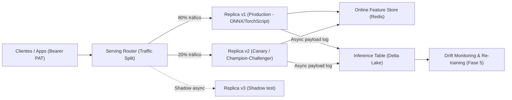

# Fase 4 — Dedicated Model Serving, Interactive Workspace & Verticales Multimodales (CV + Time Series)

> **Timeline:** Q4 2027 (Octubre — Diciembre)  
> **Estado:** 📐 Planificada  
> **Carácter:** Desacoplamiento del Model Serving, experiencia Code-First (Notebooks/SQL/SDK/Bundles) y expansión multimodal como Plugins  
> **Dependencias:** Fase 2 (Plugins + Compute Plane + PATs) · Fase 3 (Lakehouse + Praxis Catalog + Feature Store)  
> 📖 **Documentos relacionados:** [roadmap.md](../roadmap.md) · [Detalle CV & Time Series](phase-2-cv-timeseries.md)

---

## 1. Visión General

Con un núcleo modular (Fase 2) y un Lakehouse gobernado (Fase 3), la Fase 4 completa los pilares visibles de una plataforma tipo Databricks:

1. **Dedicated Model Serving Plane:** Extraer la inferencia fuera del proceso FastAPI hacia endpoints dedicados con versionado, **A/B & Canary routing**, autoscaling e **Inference Tables** automáticas en Delta Lake.
2. **AI Gateway v2 (estilo Mosaic AI Gateway):** Guardrails, caché semántica, fallbacks multi-provider, Prompt Registry y evaluación RAG/LLM.
3. **Interactive Workspace & Developer Experience (DX):** **Notebooks** (JupyterLab / Marimo), **SQL Explorer**, **Python SDK (`praxisml-sdk`)**, **CLI (`praxis`)** y **Asset Bundles (`praxis.yml` GitOps)**.
4. **Plugins Computer Vision & Time Series:** Despliegue limpio de ambas verticales sobre el contrato `DomainPlugin`, con dependencias opcionales `[cv]` y `[ts]` en workers especializados.

---

## 2. Dedicated Model Serving Plane (Sub-fase 4.1)

### Por Qué Evolucionar el Serving Plane (de Lite Serving F2.8 a Dedicated Serving F4.1)
En **Fase 2.8 (Lite Serving)** cualquier modelo registrado ya puede publicarse como endpoint dedicado (`/serving/v1/{slug}/invocations`) con API Keys, Canary routing y preprocesamiento automático ejecutándose en el runtime de inferencia ligero. En **Fase 4.1**, este mismo contrato se escala hacia un **Dedicated Model Serving Plane** físicamente aislado de la API principal para soportar GPU dedicada por endpoint, autoscaling independiente, scale-to-zero e Inference Tables en Delta Lake.



### Capacidades Clave
- **Motor de Serving:** **Ray Serve** (despliegues multi-réplica/GPU) con fallback ligero a contenedores **FastAPI + ONNX Runtime / TorchScript** en Docker Compose.
- **Traffic Splitting:** Rutas configurables por peso (`v1: 90%`, `v2: 10%`), modo **Shadow** (duplica tráfico sin afectar la respuesta al cliente) y rollback instantáneo.
- **Enriquecimiento automático desde Feature Store:** El cliente puede enviar solo `entity_id` y el endpoint resuelve las features online desde Redis en <5 ms.
- **Scale-to-Zero & Autoscaling:** Réplicas mínimas configurables (`min_replicas=0` para entornos `dev`/`staging`) escalando por concurrencia/latencia p95.
- **Inference Tables automáticas:** Cada invocación (inputs, outputs, latencia, versión servida, incertidumbre) se registra de forma asíncrona (vía Redis Streams → micro-batch) en `<workspace>.gold.inference_<endpoint_name>` (Delta Lake), habilitando auditoría, etiquetado de ground truth y **drift continuo real**.

### Endpoints de Control y Serving
```text
POST   /api/v1/serving/endpoints                       # Crear endpoint (modelo, versión, compute, min/max replicas)
PATCH  /api/v1/serving/endpoints/{name}/traffic        # Actualizar pesos A/B, Canary o Shadow
GET    /api/v1/serving/endpoints/{name}/metrics        # Latencia p50/p95/p99, RPS, error rate, coste
DELETE /api/v1/serving/endpoints/{name}                # Dar de baja endpoint

POST   /serving/v1/{workspace}/{endpoint}/invocations  # Endpoint de inferencia de baja latencia
WS     /serving/v1/{workspace}/{endpoint}/stream       # Streaming dedicado
```

---

## 3. AI Gateway v2 — Estilo Mosaic AI Gateway (Sub-fase 4.2)

Evolución del `LLMGateway` implementado en Fase 1 hacia un proxy gobernado de IA Generativa:

| Capacidad | Detalle Técnico |
|---|---|
| **Fallback & Load Balancing** | Rutas de proveedor con prioridad (ej. `vLLM local` → fallback a `OpenAI` / `Anthropic` ante timeout o 429) y circuit breaker. |
| **Semantic Cache** | Cacheo por similitud coseno (`>0.96`) sobre `pgvector`/Redis por `(tenant_id, model, prompt_hash)` reduciendo costes y latencia en consultas repetitivas. |
| **Guardrails (Input/Output)** | Detección/redacción de PII (regex + NER local ligero), filtros de *prompt injection*, límites de tokens y validación de salida JSON estructurada. |
| **Prompt Registry** | Versionado de prompts y plantillas en **Praxis Catalog** (`<workspace>.prompts.<name>`) con tags `dev/staging/prod` y pruebas A/B. |
| **LLM / RAG Evaluation** | Suite automatizada para evaluar pipelines RAG y prompts (`faithfulness`, `answer_relevancy`, `context_precision`, TTFT, coste/query) registrada en MLflow. |

---

## 4. Interactive Workspace: Notebooks, SQL Explorer, SDK & Asset Bundles (Sub-fase 4.3)

Para ofrecer una experiencia comparable a Databricks, PraxisML combina su UI visual (No-Code/Low-Code) con un **Workspace Code-First**:

### 4.1 Notebooks Integrados (JupyterLab + Marimo)
- **Abstracción `NotebookRuntime`:** Lanza sesiones aisladas efímeras (contenedor Docker o Pod K8s por usuario/workspace con perfil CPU o GPU y auto-apagado por inactividad para controlar costes FinOps).
- **Runtimes soportados:**
  - **JupyterLab (default):** Estándar de facto para Data Science.
  - **Marimo (opcional):** Notebooks reactivos en Python puro (`.py`), ideales para versionado en Git y reproducibilidad.
- **Contexto preinyectado:** Variables `PRAXIS_API_URL`, `PRAXIS_TOKEN` (PAT efímero con RBAC del usuario), `PRAXIS_WORKSPACE`, `MLFLOW_TRACKING_URI` y librería `praxisml` preinstalada.
- **Ejecución parametrizada en Workflows:** Un notebook validado puede ejecutarse como nodo de un DAG de Praxis Workflows (Fase 3.3).

### 4.2 SQL & Data Explorer en Frontend
- Editor SQL con autocompletado de esquemas/tablas de Praxis Catalog (Monaco Editor), ejecución segura contra DuckDB/Delta, vista previa paginada, perfilado rápido, exportación y guardado de consultas como vistas Silver/Gold.

### 4.3 Python SDK (`praxisml-sdk`), CLI (`praxis`) y Asset Bundles (GitOps)
```python
# Ejemplo de uso de praxisml-sdk desde un Notebook o IDE local
import praxisml

px = praxisml.Client(workspace="retail_prod")
df = px.catalog.table("retail_prod.silver.events_clean").to_polars()
run = px.training.submit(domain="tabular", dataset="retail_prod.gold.churn_features", algorithm="gradient_boosting")
px.serving.deploy(model="retail_prod.models.churn_v2", endpoint="churn-live", traffic={"v1": 80, "v2": 20})
```

```yaml
# praxis.yml — Praxis Asset Bundle (inspirado en Databricks Asset Bundles - DABs)
bundle:
  name: retail-churn-platform
targets:
  dev:
    workspace: retail_dev
  prod:
    workspace: retail_prod
resources:
  workflows:
    daily_churn: ./workflows/daily_churn.yaml
  feature_views:
    customer_churn: ./features/customer_churn.sql
  serving_endpoints:
    churn_live: ./serving/churn_live.yaml
```
Comandos CLI: `praxis bundle validate`, `praxis bundle deploy --target prod`, `praxis workflows run daily_churn`.

### 4.4 Copilot Embebido (Inline) & Servidor MCP
- **Inline Copilot:** Asistencia contextual en el **SQL Explorer** (Text-to-SQL y optimización sobre DuckDB/Delta), en **Notebooks** (generar/depurar celdas con contexto del catálogo) y en **Model Serving** (proponer canary/rollback).
- **Registro de Tools de Fase 4:** `serving.deploy_endpoint`, `serving.update_traffic_split` (Tier 3 en `prod`), `notebooks.generate`, `bundles.generate`, `bundles.validate`, además de los tools de `CVPlugin` y `TimeSeriesPlugin`.
- **MCP Server (`/api/v1/mcp`):** Exposición del `CopilotToolRegistry` mediante **Model Context Protocol** con autenticación PAT + RLS + PolicyEngine para operar PraxisML desde IDEs y agentes externos.

---

## 5. Verticales Multimodales como Plugins: CV & Time Series (Sub-fases 4.4 y 4.5)

Ambas verticales (cuyo detalle completo de algoritmos, métricas y payloads se mantiene en [phase-2-cv-timeseries.md](phase-2-cv-timeseries.md)) se implementan ahora de forma 100% modular sobre los cimientos de Fases 2 y 3:

### 5.1 Plugin Computer Vision (`plugins/cv/` · extra `[cv]`)
- **Datos en Volumes:** Imágenes y máscaras se almacenan en **Praxis Catalog Volumes** (`<workspace>.volumes.<name>`) con thumbnails automáticos en MinIO/S3, evitando ZIPs gigantes en memoria.
- **Compute GPU dedicado:** Tareas enrutadas a `gpu-train` / Ray GPU workers sin afectar el API Gateway ni el worker CPU.
- **Capacidades:**
  - Image Classification (`torchvision`: MobileNetV3, EfficientNet, ResNet, ConvNeXt, ViT)
  - Semantic Segmentation (DeepLabV3, FCN, LRASPP) reutilizando directamente los estimadores de incertidumbre 2D existentes (`mc_dropout.py`, `tta.py`)
  - Object Detection (`ultralytics` YOLOv8/v11 con export ONNX/TorchScript)
  - Document Intelligence (`docTR` OCR + layout) → ingesta directa a tablas **Bronze/Silver** en Delta Lake.

### 5.2 Plugin Time Series (`plugins/timeseries/` · extra `[ts]`)
- **Integración nativa Lakehouse:** Lee directamente series temporales particionadas desde tablas Delta (Polars/DuckDB) y escribe los pronósticos con intervalos de confianza en tablas Gold.
- **Capacidades:** Stack Nixtla (`statsforecast` ARIMA/ETS/Theta/CES, `mlforecast` LightGBM/XGBoost, `neuralforecast` N-BEATS/N-HiTS/TFT/PatchTST), streaming rolling forecast y detección de anomalías temporales.

---

## 6. Plan de Implementación Fase 4

| Sub-fase | Contenido | Esfuerzo | Dependencias |
|---|---|---|---|
| **4.1** | Dedicated Model Serving Plane (Ray Serve / ONNX containers + Traffic Split + Inference Tables) | 🔴 3 sem | F2 (Compute), F3 (Delta Lake, Feature Store) |
| **4.2** | AI Gateway v2 (Fallback, Semantic Cache, Guardrails, Prompt Registry, RAG Eval) | 🟡 2 sem | F1 (LLMGateway), F3 (Catalog) |
| **4.3a** | SQL & Data Explorer en Frontend + `praxisml-sdk` + CLI `praxis` | 🟡 2-3 sem | F2 (PATs, App Router), F3 (Catalog SQL) |
| **4.3b** | Notebooks integrados (JupyterLab / Marimo) + Asset Bundles (`praxis.yml`) | 🔴 2-3 sem | 4.3a, F3 (Workflows) |
| **4.4** | `CVPlugin` (Clasificación, Segmentación + Incertidumbre, YOLO, OCR → Delta) | 🔴 3 sem | F2 (Plugin contract, GPU queue), F3 (Volumes) |
| **4.5** | `TimeSeriesPlugin` (Nixtla stack + Forecasting + Anomalías) | 🟡 2-3 sem | F2 (Plugin contract), F3 (Delta Lake) |

---

## 7. Riesgos y Mitigaciones

| Riesgo | Mitigación |
|---|---|
| **Coste de sesiones Notebook o endpoints GPU olvidados** | Auto-shutdown obligatorio por inactividad (default 30 min), `min_replicas=0` en `dev` y alertas FinOps automáticas (Fase 0). |
| **Seguridad en ejecución de código arbitrario en Notebooks** | Aislamiento estricto por contenedor/pod sin privilegios (`read-only rootfs`, límites CPU/RAM/GPU, red segmentada sin acceso directo a DB ni a credenciales de otros tenants; solo PAT con RLS). |
| **Complejidad de operar Ray Serve en local** | Mantener un `LocalServingAdapter` liviano para Docker Compose y activar `RayServeAdapter` mediante perfil/Helm en staging/prod. |

---

> [← Fase 3 — Data Lakehouse, Catalog & Workflows](phase-3-lakehouse-catalog-workflows.md) · [Volver al Roadmap principal](../roadmap.md) · [Detalle CV & Time Series](phase-2-cv-timeseries.md) · [Siguiente: Fase 5 — Smart Platform & Cloud-Native →](phase-3-smart-platform.md)
